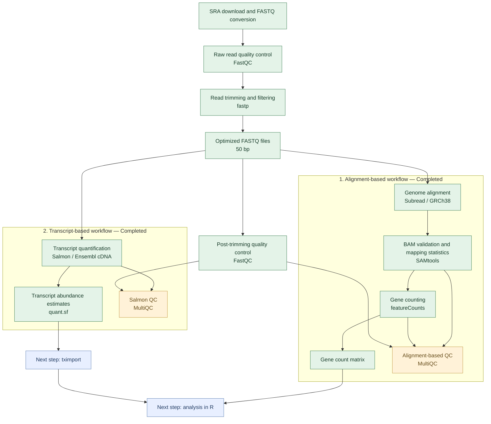
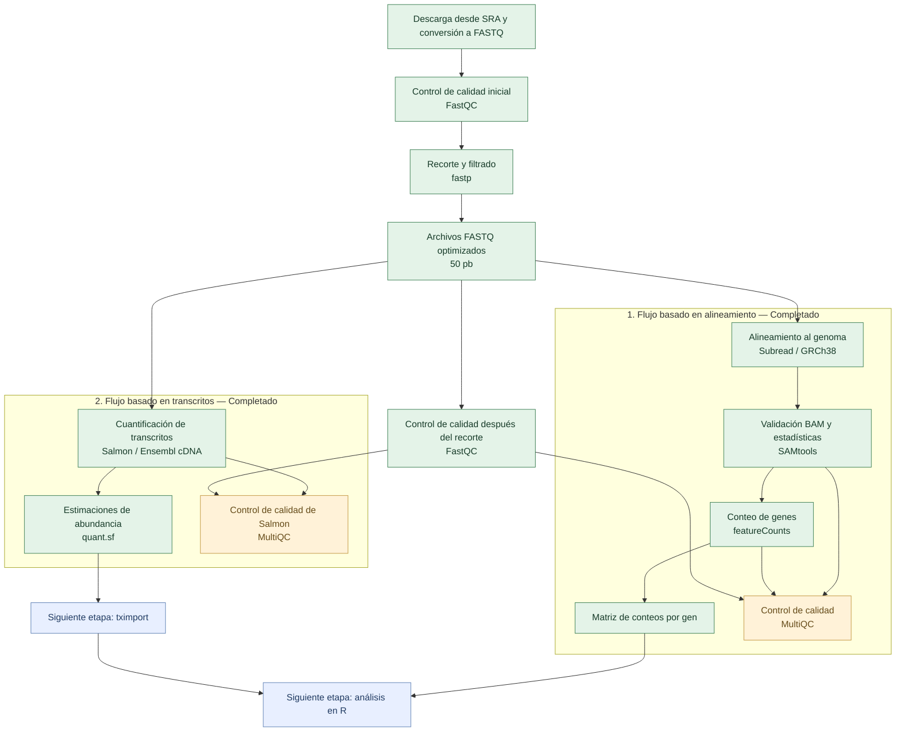

# Bulk RNA-seq Analysis Pipeline

**Dataset:** GEO GSE201955  
**Organism:** *Homo sapiens*  
**Samples:** SRR19020908, SRR19020909, SRR19020910  
**Sequencing:** Single-end RNA-seq, 51 bp  
**Reference genome:** GRCh38  
**Annotation:** Ensembl release 115

**Languages:** [English](#english) | [Español](#español)

---

# English 🇬🇧

## 1. Project overview

This repository is part of my training to create a reproducible bulk RNA-seq analysis workflow using publicly available sequencing data from GEO accession **GSE201955**, which includes RNA-seq data from human bronchial epithelial cells.

As of now, I have only selected 3 samples to test the workflow and understand what happens at each step.

The workflow covers the initial stages of RNA-seq analysis, from raw sequencing reads to gene-level counts and transcript-level abundance estimates, not with the sole goal to run the tools, but also to check the results, understand possible problems, and document the decisions I make along the way.

So far, I have completed:

1. Downloading the sequencing data.
2. Converting SRA files to FASTQ.
3. Checking raw read quality with FastQC.
4. Processing reads with fastp.
5. Comparing the original and optimized trimming results.
6. Aligning the reads to the human reference genome.
7. Checking the BAM files and alignment statistics.
8. Counting reads assigned to genes with featureCounts.
9. Quantifying transcript abundance with Salmon.
10. Generating separate MultiQC reports for the alignment-based and Salmon workflows.
11. Organizing the scripts, documentation, and final results into a clearer project structure.

The next step will be to prepare the count matrix and import the Salmon results into R using tximport.

**Differential gene expression analysis has not yet been performed.**

## 2. Dataset and samples

I am working with the following three samples:

| Sample | Sequencing type | Original read length |
|---|---|---|
| SRR19020908 | Single-end | 51 bp |
| SRR19020909 | Single-end | 51 bp |
| SRR19020910 | Single-end | 51 bp |

The sample IDs are listed in [`samples.txt`](samples.txt).

For the alignment, I used the human reference genome **GRCh38**.

For gene counting, I used the Ensembl GRCh38 release 115 annotation.

For Salmon, I used the Ensembl GRCh38 release 115 cDNA transcriptome.

This is a small test dataset. Before moving to biological comparisons, I still need to check the sample metadata and experimental design.

## 3. Repository structure

The main files and folders in this project are:

```text
prueba_RNA-seq_analisis/
├── README.md
├── .gitignore
├── samples.txt
│
├── code/
│   ├── bash/
│   │   ├── 01_download.sh
│   │   ├── 02_fastq.sh
│   │   ├── 03_fastp.sh
│   │   ├── 04_align.sh
│   │   ├── 05_featurecounts.sh
│   │   ├── 06_salmon.sh
│   │   ├── 07_multiqc_alignment.sh
│   │   └── 08_multiqc_salmon.sh
│   ├── config/
│   │   └── multiqc_config.yaml
│   └── R/
│
├── commands/
│   ├── README.md
│   └── rnaseq_workflow.md
│
├── data/
│   ├── raw_fastq/
│   ├── trimmed_fastq/
│   ├── aligned_bam/
│   └── references/
│       ├── genome/
│       ├── annotation/
│       ├── transcriptome/
│       └── indexes/
│
└── results/
    ├── quality_control/
    │   ├── fastqc_before/
    │   ├── fastqc_after/
    │   └── fastp/
    │
    ├── alignment_based/
    │   ├── mapping_statistics/
    │   ├── featurecounts/
    │   └── multiqc/
    │
    └── pseudoalignment/
        ├── salmon_quant/
        ├── tximport/
        └── multiqc/
```

Some folders contain large files that are only stored locally.

I do not upload raw FASTQ files, BAM files, reference files, Salmon quantification files, or large count tables to GitHub. Instead, I keep the scripts, documentation, and selected reports needed to understand the analysis.

The final featureCounts matrix, `gene_counts_tail1.txt`, is stored locally because it is approximately 82 MB. Its summary file is included in the repository.

The `data/` directories and some result directories may not appear on GitHub because their contents are ignored by Git.

The complete explanation of the workflow, including the commands, parameters, results, and decisions, is available here:

[RNA-seq workflow documentation](commands/rnaseq_workflow.md)

## 4. Tools and workflow

I ran the analysis in a Conda environment called `rnaseq_qc`.

These are the main tools I used:

| Tool | What I used it for |
|---|---|
| SRA Toolkit | Downloading and converting sequencing data |
| FastQC | Checking read quality |
| fastp | Filtering and trimming reads |
| Subread | Aligning reads to GRCh38 |
| SAMtools | Checking BAM files and alignment statistics |
| featureCounts | Counting reads assigned to genes |
| Salmon | Estimating transcript abundance |
| MultiQC | Combining results into QC reports |

I now have two quantification approaches. Both have been completed up to their respective quantification and quality-control steps.

### RNA-seq analysis workflow



The diagram shows the two approaches separately because they produce different types of quantification results.

The alignment-based workflow produces gene counts using Subread and featureCounts.

The Salmon workflow produces transcript-level abundance estimates without generating genome-aligned BAM files.

Both approaches use the same optimized FASTQ files.

The scripts are available in the [`code/bash/`](code/bash/) folder.

They should be run from the main project directory.

## 5. Quality control and trimming

### 5.1 What I found in the raw reads

I first checked the raw FASTQ files with FastQC.

The main issues were:

- Lower sequencing quality at the last base (position 51).
- Higher `N` content at the last base.
- Uneven nucleotide composition at the beginning of the reads, mainly along the first 13 positions.

The problem at the last base was consistent across the three samples, so I decided to test whether removing that base would improve the results.

I did not remove the first 13 bases because the nucleotide composition pattern could be related to the RNA-seq library preparation. I did not want to trim those positions without a clear reason.

### 5.2 Original and optimized trimming

I first processed the reads using fastp with its standard settings and saved the output as:

```text
_clean.fastq.gz
```

After reviewing the FastQC results, I tested a second approach using an additional fastp setting:

```bash
--trim_tail1 1
```

This removes one base from the 3′ end of each read.

The optimized output files are named:

```text
_tail1.fastq.gz
```

I initially kept both versions so I could compare the results instead of replacing the original files.

After completing the comparison and documenting the results, I removed the intermediate files from the original trimming strategy. I kept the optimized FASTQ files for the final analyses.

### 5.3 How many reads were retained?

| Sample | Raw reads | Reads after optimized fastp | Retained |
|---|---:|---:|---:|
| SRR19020908 | 3,075,016 | 3,055,200 | 99.36% |
| SRR19020909 | 3,562,425 | 3,543,079 | 99.46% |
| SRR19020910 | 3,629,875 | 3,615,115 | 99.59% |

The Q30 percentages after filtering were approximately 99% for all three samples.

The optimized strategy also retained slightly more reads than the original fastp processing:

| Sample | Additional reads retained |
|---|---:|
| SRR19020908 | +929 |
| SRR19020909 | +1,049 |
| SRR19020910 | +1,100 |

The differences are small, but the optimized strategy gave better results for the problem I was trying to correct.

### 5.4 FastQC after optimized trimming

After trimming the last base, I ran FastQC again.

| FastQC module | Result |
|---|---|
| Per base sequence quality | PASS |
| Per sequence quality scores | PASS |
| Per base N content | PASS |
| Per base sequence content | FAIL |
| Per sequence GC content | PASS |
| Adapter Content | PASS |
| Overrepresented sequences | PASS |
| Sequence Length Distribution | WARNING |

The problems with quality and `N` content at the last base were resolved.

The **Per base sequence content** module still failed.

I decided not to apply additional trimming just to make every FastQC module pass. I think it is more important to understand why a warning appears than to remove data without knowing whether that is necessary.

The full analysis and comparison between the different fastp results are documented here:

[FastQC and trimming analysis](commands/rnaseq_workflow.md)

The final FastQC reports are available in:

- [`results/quality_control/fastqc_before/`](results/quality_control/fastqc_before/)
- [`results/quality_control/fastqc_after/`](results/quality_control/fastqc_after/)

The final fastp reports are available in:

[`results/quality_control/fastp/`](results/quality_control/fastp/)

## 6. Alignment to the reference genome

After selecting the optimized reads, I aligned them to the human reference genome GRCh38 using Subread.

The script is:

[`code/bash/04_align.sh`](code/bash/04_align.sh)

The new BAM files were saved with the `_tail1.bam` suffix so the original BAM files would not be overwritten and I could still use them for later comparisons.

After completing the comparisons, I removed the older BAM files and kept the optimized versions locally.

### Alignment results

| Sample | Input reads | Mapped reads | Mapping rate |
|---|---:|---:|---:|
| SRR19020908 | 3,055,200 | 2,714,036 | 88.83% |
| SRR19020909 | 3,543,079 | 3,156,878 | 89.10% |
| SRR19020910 | 3,615,115 | 3,228,911 | 89.32% |

The mapping rates were similar across all three samples.

I also checked the BAM files using:

```bash
samtools quickcheck -v data/aligned_bam/*_tail1.bam
```

All three files passed the check.

After that, I generated SAMtools `flagstat` reports to include the mapping statistics in MultiQC.

The final mapping statistics are available here:

[`results/alignment_based/mapping_statistics/`](results/alignment_based/mapping_statistics/)

## 7. Gene counting with featureCounts

Once the BAM files were ready, I used featureCounts to count reads assigned to genes.

The script is:

[`code/bash/05_featurecounts.sh`](code/bash/05_featurecounts.sh)

I used the following annotation:

```text
data/references/annotation/Homo_sapiens.GRCh38.115.gtf.gz
```

The main parameters were:

```bash
-T 2
-t exon
-g gene_id
-s 0
```

I compared the different strandedness settings in featureCounts to see which one assigned the most reads to genes.

The unstranded setting (`-s 0`) gave the highest number of assigned reads, so I decided to use it for the final gene counts. This result supports the choice of unstranded counting, although the number of assigned reads alone does not definitively confirm the library preparation method.

For other RNA-seq datasets, strandedness information may already be available in the study documentation. It is useful to check the GEO or SRA metadata, the original publication, and especially the library preparation methods or sequencing protocol.

If this information is not available or is unclear, strandedness can be investigated by comparing featureCounts results using `-s 0`, `-s 1`, and `-s 2`, or by using a tool such as RSeQC (`infer_experiment.py`).

It is important to check this before gene counting because using the wrong strandedness setting can affect the number of reads assigned to genes.

The optimized results were saved in:

```text
results/alignment_based/featurecounts/gene_counts_tail1.txt
```

The count matrix is stored locally. Its summary file is available on GitHub:

[`gene_counts_tail1.txt.summary`](results/alignment_based/featurecounts/gene_counts_tail1.txt.summary)

### 7.1 Why I repeated the analysis

I initially processed the reads using fastp and continued with alignment and gene counting. At that point, I had not yet performed a separate FastQC analysis.

After going over my workflow with my professor, he pointed out that I had skipped FastQC. He explained that although fastp provides quality statistics and reports, I should also examine the sequencing data independently before deciding whether additional trimming is necessary.

I therefore went back to the raw FASTQ files and ran FastQC. This helped me identify the lower quality and increased N content at the final base, as well as the nucleotide composition bias at the beginning of the reads.

Based on these results, I decided to test an optimized fastp strategy using `--trim_tail1 1`. I then repeated FastQC, alignment, and gene counting so I could compare both workflows.

Using FastQC together with fastp was useful because the tools provide complementary information. FastQC gives clear figures showing quality patterns across read positions, nucleotide composition, GC content, and other potential problems. These figures made it easier for me to identify what needed attention and to evaluate the results of fastp more carefully.

The comparison also helped me understand that a trimming decision should be based on the quality of the data, not only on whether a tool finishes successfully.

### 7.2 Gene assignment results

| Sample | Assigned reads | Assignment rate |
|---|---:|---:|
| SRR19020908 | 2,093,666 | 68.5% |
| SRR19020909 | 2,563,479 | 72.4% |
| SRR19020910 | 2,572,873 | 71.2% |

I also compared the gene counts from the initial and optimized workflows.

| Sample | Original assigned reads | Optimized assigned reads | Difference |
|---|---:|---:|---:|
| SRR19020908 | 2,093,495 | 2,093,666 | +171 |
| SRR19020909 | 2,563,077 | 2,563,479 | +402 |
| SRR19020910 | 2,572,872 | 2,572,873 | +1 |

The differences were very small.

This suggests that trimming the final base improved the read quality without substantially changing the gene counting results.

## 8. Transcript quantification with Salmon

After completing the alignment-based workflow, I also wanted to test a different approach for quantifying RNA-seq data.

Instead of aligning the reads to the entire reference genome and counting reads assigned to genes, Salmon estimates transcript abundance using a transcriptome reference.

I used the same optimized FASTQ files as in the alignment-based workflow, so both approaches started from the same processed sequencing data.

The script is:

[`code/bash/06_salmon.sh`](code/bash/06_salmon.sh)

### 8.1 Transcriptome reference and index

For Salmon, I used the Ensembl GRCh38 release 115 cDNA transcriptome.

I created a Salmon index using a k-mer length of 21:

```bash
-k 21
```

I selected this value because the reads were relatively short, approximately 50 bp after trimming.

However, I have not independently tested whether this k-mer length is optimal for this dataset.

The index was created from the Ensembl cDNA sequences without adding genomic decoy sequences.

This is important because a transcriptome-only index may not distinguish some reads originating from similar genomic sequences as effectively as a decoy-aware index.

### 8.2 Salmon quantification settings

I used Salmon version 2.8.0 with the following main settings:

```bash
--sketch
-l U
--fldMean 250
--fldSD 25
```

The `--sketch` option uses Salmon's pseudoalignment mode.

I used `-l U` to specify an unstranded single-end library, consistent with the provisional choice made during featureCounts analysis.

However, I still need to verify the actual library strandedness using the study metadata or an independent method.

For the fragment length distribution, I used an assumed mean of 250 bp and a standard deviation of 25 bp.

These values were not measured from the sequencing data.

For single-end RNA-seq, Salmon cannot directly estimate the full fragment length distribution from paired reads, so these assumptions can influence effective transcript lengths and abundance estimates.

I want to review the library preparation information before using these results for biological interpretation.

### 8.3 Salmon results

Salmon completed transcript quantification for all three samples.

| Sample | Salmon mapping rate |
|---|---:|
| SRR19020908 | 83.47% |
| SRR19020909 | Approximately 87.4% |
| SRR19020910 | 85.21% |

The mapping rates were reasonably similar across the three samples.

These percentages should not be interpreted as directly equivalent to the Subread genome-alignment percentages because the two approaches use different references and mapping methods.

Salmon generated a `quant.sf` file for each sample.

These files contain transcript-level abundance estimates, including TPM values and estimated read counts.

The quantification files are stored locally in:

```text
results/pseudoalignment/salmon_quant/
```

I have not yet imported these files into R or summarized them at gene level.

### 8.4 Limitations and possible improvements

The current Salmon workflow was useful for learning how transcript-level quantification differs from genome alignment and gene counting.

However, there are some aspects I still want to review:

1. Confirm the library strandedness using the study metadata or an independent method.
2. Check whether the assumed fragment length distribution is appropriate for this library.
3. Evaluate whether a decoy-aware transcriptome index would improve the analysis.
4. Consider Salmon selective alignment as an alternative to the `--sketch` mode used here.
5. Import the `quant.sf` files into R using tximport and a transcript-to-gene mapping consistent with Ensembl release 115.

Salmon's documentation describes selective alignment and sketch mode as different mapping approaches. Selective alignment evaluates candidate mappings using alignment scores, while sketch mode uses a faster pseudoalignment strategy.

I have not rerun the analysis using selective alignment or a decoy-aware index. These are possible future improvements, not completed steps.

## 9. MultiQC reports

I generated separate MultiQC reports because I wanted to keep the different processing stages clear.

During the development of the workflow, I created intermediate reports to compare the original reads, the default fastp processing, and the optimized trimming strategy.

After documenting those comparisons, I removed the older intermediate reports and kept the two final reports.

### 9.1 Final alignment-based MultiQC report

For the final alignment-based report, I combined:

- FastQC results from the optimized reads.
- fastp results from the optimized processing.
- SAMtools `flagstat` statistics.
- featureCounts assignment statistics.

At first, MultiQC displayed multiple rows for the same sample because different tools used slightly different sample names.

This was solved by using a configuration file to standardize the sample names.

Now the **General Statistics** table shows three rows, one for each sample, with results from the different tools combined.

**Final alignment-based report:**

[Download the final alignment-based MultiQC report](results/alignment_based/multiqc/multiqc_final_tail1.html)

### 9.2 Final Salmon MultiQC report

I also generated a separate MultiQC report for the Salmon workflow.

This report includes:

- Salmon mapping and quantification statistics.
- Salmon library-format information.
- Fragment length distribution information.
- fastp statistics.
- FastQC results from the optimized reads.

I used the same sample-name configuration so the results could be organized consistently across the three samples.

**Final Salmon report:**

[Download the final Salmon MultiQC report](results/pseudoalignment/multiqc/multiqc_salmon_final.html)

### 9.3 MultiQC configuration

Both reports use the same configuration file:

[View the MultiQC configuration](code/config/multiqc_config.yaml)

The scripts used to generate the reports are:

- [`07_multiqc_alignment.sh`](code/bash/07_multiqc_alignment.sh)
- [`08_multiqc_salmon.sh`](code/bash/08_multiqc_salmon.sh)

**Note:** GitHub may not preview the HTML files because of their size. To view the interactive reports, download the raw HTML files and open them in a browser.

## 10. What I learned from the results

The optimized pipeline worked for all three samples.

The main results were:

- More than 99% of the reads were retained after filtering.
- Q30 was approximately 99% for all samples.
- Removing the final base corrected the quality and `N` content issues.
- Mapping rates with Subread were between 88.83% and 89.32%.
- Gene assignment rates with featureCounts were between 68.5% and 72.4%.
- All optimized BAM files passed validation.
- The optimized and original gene counts were very similar.
- Salmon successfully generated transcript abundance estimates for all three samples.
- The two quantification approaches produced their own results and quality-control reports.

I also learned that mapping and assignment percentages need to be interpreted in the context of the reference, annotation, and method being used.

A higher percentage does not automatically mean that one approach is biologically more accurate.

The next step is to understand how the different quantification results can be used in R and whether the sample metadata supports meaningful biological comparisons.

## 11. Next steps

The next part of the project will focus on working with the gene counts and transcript abundance estimates in R.

I plan to:

1. Import the featureCounts output.
2. Prepare the count matrix.
3. Import the Salmon `quant.sf` files using tximport.
4. Prepare a transcript-to-gene mapping using the corresponding Ensembl annotation.
5. Review the sample metadata and experimental groups.
6. Confirm library strandedness.
7. Review the fragment length assumptions used for Salmon.
8. Explore the data using PCA and sample clustering.
9. Compare the results from the alignment-based and Salmon workflows where appropriate.
10. Check whether the experimental design supports differential expression analysis with DESeq2.
11. Document the results and any decisions made during the analysis.

I also want to improve the reproducibility of the workflow by documenting reference preparation and index creation more explicitly.

## 12. References and documentation

The following resources were used to understand the tools and methods included in this project.

### Dataset and reference

- [GEO GSE201955](https://www.ncbi.nlm.nih.gov/geo/query/acc.cgi?acc=GSE201955)
- [Ensembl human genome](https://www.ensembl.org/Homo_sapiens/Info/Index)
- [Ensembl FTP archive — release 115](https://ftp.ensembl.org/pub/release-115/)

### Quality control and alignment

- [SRA Toolkit documentation](https://github.com/ncbi/sra-tools/wiki)
- [FastQC](https://www.bioinformatics.babraham.ac.uk/projects/fastqc/)
- [fastp — Chen et al., 2018](https://doi.org/10.1093/bioinformatics/bty560)
- [Subread — Liao et al., 2013](https://doi.org/10.1093/nar/gkt214)
- [featureCounts — Liao et al., 2014](https://doi.org/10.1093/bioinformatics/btt656)
- [SAMtools — Li et al., 2009](https://doi.org/10.1093/bioinformatics/btp352)
- [MultiQC — Ewels et al., 2016](https://doi.org/10.1093/bioinformatics/btw354)

### Salmon and downstream analysis

- [Salmon documentation](https://salmon.readthedocs.io/)
- [Salmon mapping modes: selective alignment and sketch mode](https://combine-lab.github.io/salmon/guides/mapping-modes/)
- [Salmon — Patro et al., 2017](https://doi.org/10.1038/nmeth.4197)
- [tximport — Bioconductor](https://bioconductor.org/packages/tximport/)
- [tximport — Soneson, Love and Robinson, 2015](https://doi.org/10.12688/f1000research.7563.1)
- [DESeq2 — Love, Huber and Anders, 2014](https://doi.org/10.1186/s13059-014-0550-8)
- [RSeQC — Wang et al., 2012](https://doi.org/10.1093/bioinformatics/bts356)

---

# Español 🇪🇸

## 1. Descripción general del proyecto

Este repositorio forma parte de mi proceso de aprendizaje para crear un flujo de trabajo reproducible de análisis de bulk RNA-seq utilizando datos públicos de secuenciación de GEO, correspondientes al acceso **GSE201955**, que incluye datos de RNA-seq de células epiteliales bronquiales humanas.

Por ahora, solamente he seleccionado 3 muestras para probar el flujo de trabajo y entender qué ocurre en cada etapa.

El análisis cubre las primeras etapas del procesamiento de RNA-seq, desde las lecturas originales hasta el conteo de lecturas por gen y la estimación de abundancia a nivel de transcritos. Mi objetivo no es solamente ejecutar las herramientas, sino también revisar los resultados, entender los posibles problemas y documentar las decisiones que voy tomando durante el proceso.

Hasta ahora he completado:

1. La descarga de los datos de secuenciación.
2. La conversión de los archivos SRA a FASTQ.
3. La evaluación de la calidad de las lecturas originales con FastQC.
4. El procesamiento de las lecturas con fastp.
5. La comparación entre los resultados del recorte original y el optimizado.
6. El alineamiento de las lecturas al genoma de referencia humano.
7. La revisión de los archivos BAM y las estadísticas de alineamiento.
8. El conteo de las lecturas asignadas a genes con featureCounts.
9. La cuantificación de la abundancia de transcritos con Salmon.
10. La generación de informes MultiQC separados para los flujos de trabajo basados en alineamiento y Salmon.
11. La organización de los scripts, la documentación y los resultados finales en una estructura más clara.

El siguiente paso será preparar la matriz de conteos e importar los resultados de Salmon en R utilizando tximport.

**Todavía no he realizado el análisis de expresión diferencial.**

## 2. Datos y muestras

Estoy trabajando con las siguientes tres muestras:

| Muestra | Tipo de secuenciación | Longitud original de las lecturas |
|---|---|---|
| SRR19020908 | Single-end | 51 pb |
| SRR19020909 | Single-end | 51 pb |
| SRR19020910 | Single-end | 51 pb |

Los identificadores de las muestras están en [`samples.txt`](samples.txt).

Para el alineamiento utilicé el genoma de referencia humano **GRCh38**.

Para el conteo de genes utilicé la anotación Ensembl GRCh38, versión 115.

Para Salmon utilicé el transcriptoma cDNA de Ensembl GRCh38, versión 115.

Este es un conjunto pequeño de muestras para probar el análisis. Antes de realizar comparaciones biológicas, todavía necesito revisar los metadatos de las muestras y el diseño experimental.

## 3. Estructura del repositorio

Los principales archivos y carpetas de este proyecto son:

```text
prueba_RNA-seq_analisis/
├── README.md
├── .gitignore
├── samples.txt
│
├── code/
│   ├── bash/
│   │   ├── 01_download.sh
│   │   ├── 02_fastq.sh
│   │   ├── 03_fastp.sh
│   │   ├── 04_align.sh
│   │   ├── 05_featurecounts.sh
│   │   ├── 06_salmon.sh
│   │   ├── 07_multiqc_alignment.sh
│   │   └── 08_multiqc_salmon.sh
│   ├── config/
│   │   └── multiqc_config.yaml
│   └── R/
│
├── commands/
│   ├── README.md
│   └── rnaseq_workflow.md
│
├── data/
│   ├── raw_fastq/
│   ├── trimmed_fastq/
│   ├── aligned_bam/
│   └── references/
│       ├── genome/
│       ├── annotation/
│       ├── transcriptome/
│       └── indexes/
│
└── results/
    ├── quality_control/
    │   ├── fastqc_before/
    │   ├── fastqc_after/
    │   └── fastp/
    │
    ├── alignment_based/
    │   ├── mapping_statistics/
    │   ├── featurecounts/
    │   └── multiqc/
    │
    └── pseudoalignment/
        ├── salmon_quant/
        ├── tximport/
        └── multiqc/
```

Algunas carpetas contienen archivos grandes que solamente guardo de manera local.

No subo los archivos FASTQ originales, los archivos BAM, los archivos de referencia, los archivos de cuantificación de Salmon ni las tablas de conteos grandes a GitHub. En su lugar, mantengo los scripts, la documentación y algunos informes seleccionados que permiten entender el análisis.

La matriz final de featureCounts, `gene_counts_tail1.txt`, se conserva localmente porque ocupa aproximadamente 82 MB. Su archivo de resumen sí está incluido en el repositorio.

Es posible que las carpetas `data/` y algunos directorios de resultados no aparezcan en GitHub porque sus archivos están excluidos mediante Git.

La explicación completa del flujo de trabajo, incluyendo los comandos, parámetros, resultados y decisiones, está disponible aquí:

[Documentación del flujo de trabajo de RNA-seq](commands/rnaseq_workflow.md)

## 4. Herramientas y flujo de trabajo

Realicé el análisis en un entorno Conda llamado `rnaseq_qc`.

Estas son las principales herramientas que utilicé:

| Herramienta | Para qué la utilicé |
|---|---|
| SRA Toolkit | Descargar y convertir los datos de secuenciación |
| FastQC | Revisar la calidad de las lecturas |
| fastp | Filtrar y recortar las lecturas |
| Subread | Alinear las lecturas a GRCh38 |
| SAMtools | Revisar los archivos BAM y las estadísticas de alineamiento |
| featureCounts | Contar las lecturas asignadas a genes |
| Salmon | Estimar la abundancia de transcritos |
| MultiQC | Combinar los resultados en informes de control de calidad |

Ahora tengo dos enfoques de cuantificación. Ambos se han completado hasta sus respectivas etapas de cuantificación y control de calidad.

### Flujo de trabajo de RNA-seq



El diagrama muestra los dos enfoques por separado porque producen diferentes tipos de resultados de cuantificación.

El flujo basado en alineamiento genera conteos por gen utilizando Subread y featureCounts.

El flujo de Salmon genera estimaciones de abundancia a nivel de transcritos sin producir archivos BAM alineados al genoma.

Ambos enfoques utilizan los mismos archivos FASTQ optimizados.

Los scripts están disponibles en la carpeta [`code/bash/`](code/bash/).

Deben ejecutarse desde el directorio principal del proyecto.

## 5. Control de calidad y recorte

### 5.1 Qué encontré en las lecturas originales

Primero revisé los archivos FASTQ originales con FastQC.

Los principales problemas fueron:

- Menor calidad de secuenciación en la última base (posición 51).
- Mayor contenido de `N` en la última base.
- Composición desigual de nucleótidos al inicio de las lecturas, principalmente durante las primeras 13 posiciones.

El problema de la última base aparecía en las tres muestras, por lo que decidí probar si eliminar esa base mejoraba los resultados.

No eliminé las primeras 13 bases porque el patrón de composición nucleotídica podría estar relacionado con la preparación de la biblioteca de RNA-seq. No quería recortar esas posiciones sin tener una razón clara.

### 5.2 Recorte original y optimizado

Primero procesé las lecturas utilizando fastp con su configuración estándar y guardé los archivos de salida con el sufijo:

```text
_clean.fastq.gz
```

Después de revisar los resultados de FastQC, probé una segunda estrategia añadiendo un parámetro a fastp:

```bash
--trim_tail1 1
```

Este parámetro elimina una base del extremo 3′ de cada lectura.

Los archivos optimizados tienen el sufijo:

```text
_tail1.fastq.gz
```

Inicialmente conservé las dos versiones para poder comparar los resultados sin reemplazar los archivos originales.

Después de completar la comparación y documentar los resultados, eliminé los archivos intermedios del procesamiento original. Conservé los archivos FASTQ optimizados para los análisis finales.

### 5.3 ¿Cuántas lecturas se conservaron?

| Muestra | Lecturas originales | Lecturas después de fastp optimizado | Retención |
|---|---:|---:|---:|
| SRR19020908 | 3,075,016 | 3,055,200 | 99.36% |
| SRR19020909 | 3,562,425 | 3,543,079 | 99.46% |
| SRR19020910 | 3,629,875 | 3,615,115 | 99.59% |

Los porcentajes Q30 después del filtrado fueron aproximadamente del 99% en las tres muestras.

La estrategia optimizada también conservó un poco más de lecturas que el procesamiento original con fastp:

| Muestra | Lecturas adicionales conservadas |
|---|---:|
| SRR19020908 | +929 |
| SRR19020909 | +1,049 |
| SRR19020910 | +1,100 |

Las diferencias son pequeñas, pero la estrategia optimizada dio mejores resultados para el problema que estaba intentando corregir.

### 5.4 FastQC después del recorte optimizado

Después de eliminar la última base, ejecuté FastQC nuevamente.

| Módulo FastQC | Resultado |
|---|---|
| Per base sequence quality | PASS |
| Per sequence quality scores | PASS |
| Per base N content | PASS |
| Per base sequence content | FAIL |
| Per sequence GC content | PASS |
| Adapter Content | PASS |
| Overrepresented sequences | PASS |
| Sequence Length Distribution | WARNING |

Los problemas de calidad y contenido de `N` en la última base se corrigieron.

El módulo **Per base sequence content** todavía presentó un resultado FAIL.

Decidí no realizar un recorte adicional solamente para conseguir que todos los módulos de FastQC mostraran PASS. Considero más importante entender por qué aparece una advertencia que eliminar datos sin saber si realmente es necesario.

El análisis completo y la comparación entre los diferentes resultados de fastp están documentados aquí:

[Análisis de FastQC y recorte](commands/rnaseq_workflow.md)

Los informes finales de FastQC están disponibles en:

- [`results/quality_control/fastqc_before/`](results/quality_control/fastqc_before/)
- [`results/quality_control/fastqc_after/`](results/quality_control/fastqc_after/)

Los informes finales de fastp están disponibles en:

[`results/quality_control/fastp/`](results/quality_control/fastp/)

## 6. Alineamiento al genoma de referencia

Después de seleccionar las lecturas optimizadas, las alineé al genoma de referencia humano GRCh38 utilizando Subread.

El script es:

[`code/bash/04_align.sh`](code/bash/04_align.sh)

Guardé los nuevos archivos BAM con el sufijo `_tail1.bam` para no sobrescribir los archivos BAM originales y poder conservarlos para comparaciones posteriores.

Después de completar las comparaciones, eliminé los archivos BAM anteriores y conservé localmente las versiones optimizadas.

### Resultados del alineamiento

| Muestra | Lecturas de entrada | Lecturas alineadas | Porcentaje de alineamiento |
|---|---:|---:|---:|
| SRR19020908 | 3,055,200 | 2,714,036 | 88.83% |
| SRR19020909 | 3,543,079 | 3,156,878 | 89.10% |
| SRR19020910 | 3,615,115 | 3,228,911 | 89.32% |

Los porcentajes de alineamiento fueron similares entre las tres muestras.

También revisé los archivos BAM utilizando:

```bash
samtools quickcheck -v data/aligned_bam/*_tail1.bam
```

Los tres archivos pasaron la validación.

Después generé los informes `flagstat` de SAMtools para incluir las estadísticas de alineamiento en MultiQC.

Las estadísticas finales están disponibles aquí:

[`results/alignment_based/mapping_statistics/`](results/alignment_based/mapping_statistics/)

## 7. Conteo de genes con featureCounts

Una vez que los archivos BAM estuvieron listos, utilicé featureCounts para contar las lecturas asignadas a genes.

El script es:

[`code/bash/05_featurecounts.sh`](code/bash/05_featurecounts.sh)

Utilicé la siguiente anotación:

```text
data/references/annotation/Homo_sapiens.GRCh38.115.gtf.gz
```

Los parámetros principales fueron:

```bash
-T 2
-t exon
-g gene_id
-s 0
```

Comparé las diferentes opciones de especificidad de cadena en featureCounts para ver cuál permitía asignar más lecturas a los genes.

La opción no específica de cadena (`-s 0`) produjo el mayor número de lecturas asignadas, por lo que decidí utilizarla para los conteos finales. Este resultado respalda la elección de un conteo no específico de cadena, aunque el número de lecturas asignadas por sí solo no confirma de manera definitiva el método de preparación de la biblioteca.

En otros conjuntos de datos de RNA-seq, esta información puede estar disponible en la documentación del estudio. Es útil revisar los metadatos de GEO o SRA, la publicación original y, especialmente, los métodos de preparación de la biblioteca o el protocolo de secuenciación.

Si esta información no está disponible o no es clara, se puede investigar la especificidad de cadena comparando los resultados de featureCounts con `-s 0`, `-s 1` y `-s 2`, o utilizando una herramienta como RSeQC (`infer_experiment.py`).

Es importante comprobar este aspecto antes del conteo de genes porque utilizar una configuración incorrecta puede afectar la cantidad de lecturas asignadas a los genes.

Los resultados optimizados se guardaron en:

```text
results/alignment_based/featurecounts/gene_counts_tail1.txt
```

La matriz de conteos se conserva localmente. Su archivo de resumen está disponible en GitHub:

[`gene_counts_tail1.txt.summary`](results/alignment_based/featurecounts/gene_counts_tail1.txt.summary)

### 7.1 Por qué repetí el análisis

Inicialmente procesé las lecturas utilizando fastp y continué con el alineamiento y el conteo de genes. En ese momento todavía no había realizado un análisis independiente con FastQC.

Después de revisar mi flujo de trabajo con mi profesor, me señaló que había omitido FastQC. Me explicó que, aunque fastp genera estadísticas e informes de calidad, también era importante revisar los datos de secuenciación de manera independiente antes de decidir si era necesario realizar algún recorte adicional.

Por eso regresé a los archivos FASTQ originales y ejecuté FastQC. Esto me permitió identificar la menor calidad y el aumento del contenido de `N` en la última base, además del sesgo de composición nucleotídica al inicio de las lecturas.

Con base en estos resultados, decidí probar una estrategia optimizada de fastp utilizando `--trim_tail1 1`. Después repetí FastQC, el alineamiento y el conteo de genes para poder comparar ambos procedimientos.

Utilizar FastQC junto con fastp fue útil porque las dos herramientas proporcionan información complementaria. FastQC genera figuras claras sobre la calidad a lo largo de las lecturas, la composición de nucleótidos, el contenido de GC y otros posibles problemas. Estas figuras me ayudaron a identificar qué aspectos necesitaban atención y a evaluar con más detalle los resultados de fastp.

Esta comparación también me permitió entender que las decisiones de recorte deben basarse en la calidad de los datos y no solamente en que una herramienta haya terminado correctamente.

### 7.2 Resultados de asignación a genes

| Muestra | Lecturas asignadas | Porcentaje de asignación |
|---|---:|---:|
| SRR19020908 | 2,093,666 | 68.5% |
| SRR19020909 | 2,563,479 | 72.4% |
| SRR19020910 | 2,572,873 | 71.2% |

También comparé los conteos de genes del procesamiento inicial con los del procesamiento optimizado.

| Muestra | Lecturas asignadas originales | Lecturas asignadas optimizadas | Diferencia |
|---|---:|---:|---:|
| SRR19020908 | 2,093,495 | 2,093,666 | +171 |
| SRR19020909 | 2,563,077 | 2,563,479 | +402 |
| SRR19020910 | 2,572,872 | 2,572,873 | +1 |

Las diferencias fueron muy pequeñas.

Esto sugiere que eliminar la última base mejoró la calidad de las lecturas sin cambiar de manera importante los resultados del conteo de genes.

## 8. Cuantificación de transcritos con Salmon

Después de completar el flujo de trabajo basado en alineamiento, también quise probar un enfoque diferente para cuantificar los datos de RNA-seq.

En lugar de alinear las lecturas al genoma completo y contar las lecturas asignadas a genes, Salmon estima la abundancia de transcritos utilizando una referencia del transcriptoma.

Utilicé los mismos archivos FASTQ optimizados que en el flujo basado en alineamiento, de manera que ambos enfoques partieran de los mismos datos procesados.

El script es:

[`code/bash/06_salmon.sh`](code/bash/06_salmon.sh)

### 8.1 Referencia del transcriptoma e índice

Para Salmon utilicé el transcriptoma cDNA de Ensembl GRCh38, versión 115.

Creé un índice de Salmon utilizando una longitud de k-mer de 21:

```bash
-k 21
```

Seleccioné este valor porque las lecturas eran relativamente cortas, aproximadamente 50 pb después del recorte.

Sin embargo, todavía no he comprobado de manera independiente si esta longitud de k-mer es la más adecuada para este conjunto de datos.

El índice se creó a partir de las secuencias cDNA de Ensembl, sin añadir secuencias genómicas decoy.

Esto es importante porque un índice basado únicamente en el transcriptoma puede tener más dificultades para distinguir algunas lecturas que provienen de secuencias genómicas similares.

### 8.2 Parámetros de cuantificación

Utilicé Salmon versión 2.8.0 con los siguientes parámetros principales:

```bash
--sketch
-l U
--fldMean 250
--fldSD 25
```

La opción `--sketch` utiliza el modo de pseudoalineamiento de Salmon.

Utilicé `-l U` para indicar una biblioteca single-end no específica de cadena, de acuerdo con la elección provisional realizada durante el análisis con featureCounts.

Sin embargo, todavía necesito confirmar la especificidad de cadena real mediante los metadatos del estudio o un método independiente.

Para la distribución de longitud de los fragmentos utilicé una media asumida de 250 pb y una desviación estándar de 25 pb.

Estos valores no se midieron a partir de los datos de secuenciación.

En datos single-end, Salmon no puede estimar directamente la distribución completa de longitud de los fragmentos a partir de pares de lecturas. Por eso, estas suposiciones pueden influir en las longitudes efectivas de los transcritos y en las estimaciones de abundancia.

Quiero revisar la información sobre la preparación de la biblioteca antes de utilizar estos resultados para interpretaciones biológicas.

### 8.3 Resultados de Salmon

Salmon completó la cuantificación de transcritos para las tres muestras.

| Muestra | Porcentaje de mapeo de Salmon |
|---|---:|
| SRR19020908 | 83.47% |
| SRR19020909 | Aproximadamente 87.4% |
| SRR19020910 | 85.21% |

Los porcentajes de mapeo fueron relativamente similares entre las tres muestras.

Estos porcentajes no deben interpretarse como directamente equivalentes a los porcentajes de alineamiento de Subread, porque los dos enfoques utilizan referencias y métodos de mapeo diferentes.

Salmon generó un archivo `quant.sf` para cada muestra.

Estos archivos contienen estimaciones de abundancia a nivel de transcritos, incluyendo valores TPM y conteos estimados.

Los archivos de cuantificación se conservan localmente en:

```text
results/pseudoalignment/salmon_quant/
```

Todavía no he importado estos archivos en R ni los he resumido a nivel de gen.

### 8.4 Limitaciones y posibles mejoras

El flujo de Salmon fue útil para aprender cómo la cuantificación a nivel de transcritos se diferencia del alineamiento al genoma y del conteo de genes.

Sin embargo, todavía quiero revisar algunos aspectos:

1. Confirmar la especificidad de cadena mediante los metadatos del estudio o un método independiente.
2. Comprobar si la distribución de longitud de fragmentos asumida es adecuada para esta biblioteca.
3. Evaluar si un índice del transcriptoma con secuencias decoy mejoraría el análisis.
4. Considerar el alineamiento selectivo de Salmon como alternativa al modo `--sketch` utilizado aquí.
5. Importar los archivos `quant.sf` en R mediante tximport y una correspondencia entre transcritos y genes consistente con Ensembl versión 115.

La documentación de Salmon describe el alineamiento selectivo y el modo sketch como dos enfoques diferentes. El alineamiento selectivo evalúa los posibles mapeos mediante puntuaciones de alineamiento, mientras que el modo sketch utiliza una estrategia de pseudoalineamiento más rápida.

Todavía no he repetido el análisis utilizando alineamiento selectivo ni un índice con secuencias decoy. Estas son posibles mejoras futuras, no etapas que ya haya completado.

## 9. Informes de MultiQC

Generé informes de MultiQC por separado porque quería mantener claras las diferentes etapas del procesamiento.

Durante el desarrollo del flujo de trabajo, creé informes intermedios para comparar las lecturas originales, el procesamiento estándar de fastp y la estrategia de recorte optimizada.

Después de documentar esas comparaciones, eliminé los informes intermedios anteriores y conservé los dos informes finales.

### 9.1 Informe final del flujo basado en alineamiento

Para el informe final del flujo basado en alineamiento reuní:

- Los resultados de FastQC de las lecturas optimizadas.
- Los resultados de fastp del procesamiento optimizado.
- Las estadísticas de SAMtools `flagstat`.
- Las estadísticas de asignación de featureCounts.

Al principio, MultiQC mostraba varias filas para una misma muestra porque las diferentes herramientas utilizaban nombres ligeramente distintos.

Resolví esto mediante un archivo de configuración que unifica los nombres de las muestras.

Ahora la tabla **General Statistics** muestra tres filas, una por muestra, con los resultados de las diferentes herramientas integrados.

**Informe final del flujo basado en alineamiento:**

[Descargar el informe final de MultiQC](results/alignment_based/multiqc/multiqc_final_tail1.html)

### 9.2 Informe final de Salmon

También generé un informe MultiQC separado para el flujo de Salmon.

Este informe incluye:

- Estadísticas de mapeo y cuantificación de Salmon.
- Información sobre el formato de la biblioteca.
- Información sobre la distribución de longitud de fragmentos.
- Estadísticas de fastp.
- Resultados de FastQC de las lecturas optimizadas.

Utilicé el mismo archivo de configuración para organizar los resultados de manera consistente entre las tres muestras.

**Informe final de Salmon:**

[Descargar el informe final de Salmon](results/pseudoalignment/multiqc/multiqc_salmon_final.html)

### 9.3 Configuración de MultiQC

Ambos informes utilizan el mismo archivo de configuración:

[Ver la configuración de MultiQC](code/config/multiqc_config.yaml)

Los scripts utilizados para generar los informes son:

- [`07_multiqc_alignment.sh`](code/bash/07_multiqc_alignment.sh)
- [`08_multiqc_salmon.sh`](code/bash/08_multiqc_salmon.sh)

**Nota:** GitHub puede no mostrar una vista previa de los archivos HTML debido a su tamaño. Para ver los informes interactivos, hay que descargar los archivos HTML originales y abrirlos en un navegador.

## 10. Qué aprendí de los resultados

El flujo optimizado funcionó para las tres muestras.

Los resultados principales fueron:

- Se conservó más del 99% de las lecturas después del filtrado.
- El porcentaje Q30 fue aproximadamente del 99% en las tres muestras.
- El recorte de la última base corrigió los problemas de calidad y contenido de `N`.
- Los porcentajes de alineamiento con Subread estuvieron entre 88.83% y 89.32%.
- Los porcentajes de asignación a genes con featureCounts estuvieron entre 68.5% y 72.4%.
- Todos los archivos BAM optimizados pasaron la validación.
- Los conteos de genes originales y optimizados fueron muy similares.
- Salmon generó estimaciones de abundancia de transcritos para las tres muestras.
- Los dos enfoques de cuantificación produjeron sus propios resultados e informes de control de calidad.

También aprendí que los porcentajes de mapeo y asignación deben interpretarse teniendo en cuenta la referencia, la anotación y el método utilizado.

Un porcentaje más alto no significa automáticamente que un enfoque sea biológicamente más preciso.

El siguiente paso es entender cómo utilizar los diferentes resultados de cuantificación en R y comprobar si los metadatos de las muestras permiten realizar comparaciones biológicas significativas.

## 11. Próximos pasos

La siguiente parte del proyecto estará enfocada en trabajar con los conteos de genes y las estimaciones de abundancia de transcritos en R.

Tengo previsto:

1. Importar los resultados de featureCounts.
2. Preparar la matriz de conteos.
3. Importar los archivos `quant.sf` de Salmon utilizando tximport.
4. Preparar una correspondencia entre transcritos y genes utilizando la anotación de Ensembl correspondiente.
5. Revisar los metadatos de las muestras y los grupos experimentales.
6. Confirmar la especificidad de cadena de la biblioteca.
7. Revisar las suposiciones sobre la longitud de fragmentos utilizadas en Salmon.
8. Explorar los datos mediante PCA y agrupamiento de muestras.
9. Comparar los resultados de los flujos basados en alineamiento y Salmon cuando sea apropiado.
10. Revisar si el diseño experimental permite realizar un análisis de expresión diferencial con DESeq2.
11. Documentar los resultados y las decisiones tomadas durante el análisis.

También quiero mejorar la reproducibilidad del flujo de trabajo documentando con más detalle la preparación de las referencias y la creación de los índices.

## 12. Referencias y documentación

Los siguientes recursos se utilizaron para entender las herramientas y los métodos incluidos en este proyecto.

### Datos y referencias

- [GEO GSE201955](https://www.ncbi.nlm.nih.gov/geo/query/acc.cgi?acc=GSE201955)
- [Genoma humano de Ensembl](https://www.ensembl.org/Homo_sapiens/Info/Index)
- [Archivo FTP de Ensembl — versión 115](https://ftp.ensembl.org/pub/release-115/)

### Control de calidad y alineamiento

- [Documentación de SRA Toolkit](https://github.com/ncbi/sra-tools/wiki)
- [FastQC](https://www.bioinformatics.babraham.ac.uk/projects/fastqc/)
- [fastp — Chen et al., 2018](https://doi.org/10.1093/bioinformatics/bty560)
- [Subread — Liao et al., 2013](https://doi.org/10.1093/nar/gkt214)
- [featureCounts — Liao et al., 2014](https://doi.org/10.1093/bioinformatics/btt656)
- [SAMtools — Li et al., 2009](https://doi.org/10.1093/bioinformatics/btp352)
- [MultiQC — Ewels et al., 2016](https://doi.org/10.1093/bioinformatics/btw354)

### Salmon y análisis posterior

- [Documentación de Salmon](https://salmon.readthedocs.io/)
- [Modos de mapeo de Salmon: alineamiento selectivo y sketch](https://combine-lab.github.io/salmon/guides/mapping-modes/)
- [Salmon — Patro et al., 2017](https://doi.org/10.1038/nmeth.4197)
- [tximport — Bioconductor](https://bioconductor.org/packages/tximport/)
- [tximport — Soneson, Love y Robinson, 2015](https://doi.org/10.12688/f1000research.7563.1)
- [DESeq2 — Love, Huber y Anders, 2014](https://doi.org/10.1186/s13059-014-0550-8)
- [RSeQC — Wang et al., 2012](https://doi.org/10.1093/bioinformatics/bts356)

---

**Repository / Repositorio:**  
[prueba_RNA-seq_analisis](https://github.com/viancyrn/prueba_RNA-seq_analisis)
