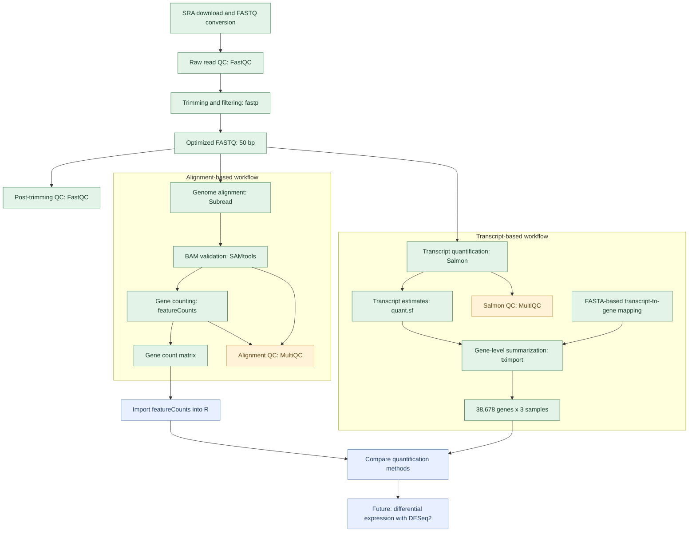

# Bulk RNA-seq Analysis Pipeline

**Dataset:** GEO GSE201955  
**Organism:** *Homo sapiens*  
**Samples:** SRR19020908, SRR19020909, SRR19020910  
**Sequencing:** Single-end RNA-seq, 51 bp  
**Reference genome:** GRCh38  
**Annotation:** Ensembl release 115

**Languages / Idiomas:** [English](#english) | [Español](#español)

---

<a id="english"></a>

# English 🇬🇧

## 1. Project overview

This repository documents my training in building a reproducible bulk RNA-seq analysis workflow using publicly available sequencing data from GEO accession **GSE201955**, which includes RNA-seq data from human bronchial epithelial cells.

I selected three samples to test the workflow and understand each processing step.

The objective is not simply to run bioinformatics tools, but to evaluate their results, investigate potential problems, understand methodological decisions, and document the analysis reproducibly.

The workflow currently includes:

- Raw sequencing data retrieval and FASTQ conversion.
- Read quality control with FastQC.
- Read filtering and trimming with fastp.
- Genome alignment with Subread.
- Alignment statistics and validation with SAMtools.
- Gene counting with featureCounts.
- Transcript quantification with Salmon.
- Quality-control summaries with MultiQC.
- Transcript-to-gene summarization using R and tximport.

**Differential gene expression analysis has not yet been performed.**

The next stage will be to import the alignment-based gene counts into R and compare them with the Salmon + tximport results.

## 2. Dataset and samples

Three samples were selected for this exploratory workflow.

| Sample | Sequencing type | Original read length |
|---|---|---|
| SRR19020908 | Single-end | 51 bp |
| SRR19020909 | Single-end | 51 bp |
| SRR19020910 | Single-end | 51 bp |

Sample identifiers are recorded in [`samples.txt`](samples.txt).

The reference resources used were:

- **Genome:** Human GRCh38.
- **Gene annotation:** Ensembl GRCh38 release 115 GTF.
- **Transcriptome:** Ensembl GRCh38 cDNA FASTA.

The sample metadata and experimental design still need to be verified before performing biological comparisons.

## 3. Repository structure

```text
prueba_RNA-seq_analisis/
├── README.md
├── .gitignore
├── samples.txt
│
├── code/
│   ├── bash/
│   │   ├── 01_download.sh
│   │   ├── 02_fastq.sh
│   │   ├── 03_fastp.sh
│   │   ├── 04_align.sh
│   │   ├── 05_featurecounts.sh
│   │   ├── 06_salmon.sh
│   │   ├── 07_multiqc_alignment.sh
│   │   └── 08_multiqc_salmon.sh
│   ├── config/
│   │   └── multiqc_config.yaml
│   └── R/
│
├── commands/
│   ├── README.md
│   └── rnaseq_workflow.md
│
├── data/
│   ├── raw_fastq/
│   ├── trimmed_fastq/
│   ├── aligned_bam/
│   └── references/
│       ├── genome/
│       ├── annotation/
│       ├── transcriptome/
│       └── indexes/
│
└── results/
    ├── quality_control/
    │   ├── fastqc_before/
    │   ├── fastqc_after/
    │   └── fastp/
    ├── alignment_based/
    │   ├── mapping_statistics/
    │   ├── featurecounts/
    │   └── multiqc/
    ├── pseudoalignment/
    │   ├── salmon_quant/
    │   └── multiqc/
    └── gene_expression/
        ├── tximport_gene_counts.rds
        └── tx2gene_fasta.rds
```

Large FASTQ, BAM, reference, and quantification files are stored locally rather than committed to GitHub.

The final featureCounts matrix, `gene_counts_tail1.txt`, is approximately 82 MB and is stored locally. Its summary file is available in the repository.

The RDS files shown above are saved locally and may also be excluded by `.gitignore`.

For detailed commands, parameters, results, and methodological decisions, see:

[RNA-seq workflow documentation](commands/rnaseq_workflow.md)

## 4. Tools and workflow

The command-line analysis was performed in a Conda environment named `rnaseq_qc`. The tximport analysis was performed in R.

| Tool | Purpose |
|---|---|
| SRA Toolkit | Sequencing data retrieval and FASTQ conversion |
| FastQC | Read quality assessment |
| fastp | Read trimming and filtering |
| Subread | Genome alignment |
| SAMtools | BAM validation and alignment statistics |
| featureCounts | Gene-level read counting |
| Salmon | Transcript abundance estimation |
| MultiQC | Combined quality-control reports |
| R / tximport | Transcript-to-gene summarization |
| DESeq2 | Planned differential expression analysis |

### RNA-seq analysis workflow



The two approaches use the same optimized FASTQ files but different quantification methods.

The alignment-based workflow generates gene counts with featureCounts.

The transcript-based workflow estimates transcript abundance with Salmon and subsequently summarizes the estimates at gene level with tximport.

The next stage is to import the featureCounts results into R and compare both quantification approaches.

The Bash scripts are available in [`code/bash/`](code/bash/) and should be run from the project root.

## 5. Quality control and trimming

### 5.1 Initial read quality

FastQC analysis of the raw sequencing reads revealed:

- Lower sequencing quality at the final base, position 51.
- Increased `N` content at the final base.
- Uneven nucleotide composition at the beginning of the reads, particularly within the first 13 positions.

The final-base quality issue was observed across all three samples.

I did not remove the first 13 bases because their nucleotide composition pattern might reflect the RNA-seq library preparation.

Trimming those positions without understanding the cause could unnecessarily remove useful sequence information.

### 5.2 Trimming strategy

The initial fastp processing used standard settings and generated files ending in:

```text
_clean.fastq.gz
```

After reviewing FastQC results, I tested an additional trimming option:

```bash
--trim_tail1 1
```

This removes one nucleotide from the 3′ end of each read.

The optimized files were named:

```text
_tail1.fastq.gz
```

Both strategies were initially retained for comparison.

After documenting the results, I removed the intermediate files from the original trimming strategy and kept the optimized FASTQ files.

### 5.3 Read retention

| Sample | Raw reads | Reads after optimized fastp | Retained |
|---|---:|---:|---:|
| SRR19020908 | 3,075,016 | 3,055,200 | 99.36% |
| SRR19020909 | 3,562,425 | 3,543,079 | 99.46% |
| SRR19020910 | 3,629,875 | 3,615,115 | 99.59% |

Q30 percentages after filtering were approximately 99% for all samples.

The optimized strategy also retained slightly more reads than the original fastp processing:

| Sample | Additional reads retained |
|---|---:|
| SRR19020908 | +929 |
| SRR19020909 | +1,049 |
| SRR19020910 | +1,100 |

These differences were small, but the optimized approach addressed the specific final-base quality issue.

### 5.4 FastQC after trimming

| FastQC module | Result |
|---|---|
| Per base sequence quality | PASS |
| Per sequence quality scores | PASS |
| Per base N content | PASS |
| Per base sequence content | FAIL |
| Per sequence GC content | PASS |
| Adapter Content | PASS |
| Overrepresented sequences | PASS |
| Sequence Length Distribution | WARNING |

Removing the last nucleotide resolved the final-base quality and `N` content problems.

The **Per base sequence content** module still failed.

I decided not to apply additional trimming simply to make all FastQC modules pass.

A warning or failure should be interpreted in the context of the sequencing protocol rather than automatically treated as a reason to remove more sequence data.

The complete trimming comparison is documented in:

[FastQC and trimming analysis](commands/rnaseq_workflow.md)

Final quality-control results:

- [`results/quality_control/fastqc_before/`](results/quality_control/fastqc_before/)
- [`results/quality_control/fastqc_after/`](results/quality_control/fastqc_after/)
- [`results/quality_control/fastp/`](results/quality_control/fastp/)

## 6. Alignment to the reference genome

The optimized reads were aligned to GRCh38 using Subread.

Script:

[`code/bash/04_align.sh`](code/bash/04_align.sh)

Optimized BAM files were saved with the suffix `_tail1.bam`.

### Alignment results

| Sample | Input reads | Mapped reads | Mapping rate |
|---|---:|---:|---:|
| SRR19020908 | 3,055,200 | 2,714,036 | 88.83% |
| SRR19020909 | 3,543,079 | 3,156,878 | 89.10% |
| SRR19020910 | 3,615,115 | 3,228,911 | 89.32% |

The mapping rates were similar across samples.

BAM integrity was checked using:

```bash
samtools quickcheck -v data/aligned_bam/*_tail1.bam
```

All three BAM files passed this check.

SAMtools `flagstat` reports were also generated for MultiQC.

Mapping statistics:

[`results/alignment_based/mapping_statistics/`](results/alignment_based/mapping_statistics/)

## 7. Gene counting with featureCounts

Gene-level read counting was performed using featureCounts.

Script:

[`code/bash/05_featurecounts.sh`](code/bash/05_featurecounts.sh)

Annotation:

```text
data/references/annotation/Homo_sapiens.GRCh38.115.gtf.gz
```

Main parameters:

```bash
-T 2
-t exon
-g gene_id
-s 0
```

The strandedness settings `-s 0`, `-s 1`, and `-s 2` were compared.

The unstranded setting (`-s 0`) produced the highest number of assigned reads and was selected for the final count matrix.

However, assignment rates alone do not establish the true library strandedness.

The original library preparation metadata or an independent method such as RSeQC should be consulted.

### 7.1 Why I repeated the analysis

Initially, I performed trimming, alignment, and gene counting without a separate FastQC analysis.

After discussing the workflow with my professor, I realized that I needed to examine the sequencing quality independently before deciding whether additional trimming was necessary.

I returned to the raw reads, ran FastQC, identified the final-base quality issue, and tested the optimized fastp strategy.

I then repeated alignment and gene counting to compare the original and optimized approaches.

This helped me understand that quality-control decisions should be based on the data rather than simply on whether a tool completes successfully.

### 7.2 Gene assignment results

| Sample | Assigned reads | Assignment rate |
|---|---:|---:|
| SRR19020908 | 2,093,666 | 68.5% |
| SRR19020909 | 2,563,479 | 72.4% |
| SRR19020910 | 2,572,873 | 71.2% |

Comparison of the original and optimized workflows:

| Sample | Original assigned reads | Optimized assigned reads | Difference |
|---|---:|---:|---:|
| SRR19020908 | 2,093,495 | 2,093,666 | +171 |
| SRR19020909 | 2,563,077 | 2,563,479 | +402 |
| SRR19020910 | 2,572,872 | 2,572,873 | +1 |

The changes in assigned reads were small.

This suggests that removing the final nucleotide improved read quality without substantially changing gene assignment.

The count matrix is stored locally at:

```text
results/alignment_based/featurecounts/gene_counts_tail1.txt
```

The summary file is available in the repository:

[`gene_counts_tail1.txt.summary`](results/alignment_based/featurecounts/gene_counts_tail1.txt.summary)

## 8. Transcript quantification with Salmon

I also tested transcript-level quantification with Salmon.

Unlike genome alignment followed by gene counting, Salmon estimates transcript abundance using a transcriptome reference.

The same optimized FASTQ files were used in both approaches.

Script:

[`code/bash/06_salmon.sh`](code/bash/06_salmon.sh)

### 8.1 Transcriptome reference and index

The Salmon index was built using the Ensembl GRCh38 release 115 cDNA transcriptome.

The index was generated using:

```bash
-k 21
```

A k-mer length of 21 was selected because the reads were relatively short, approximately 50 bp after trimming.

I have not independently established whether this k-mer length is optimal for the dataset.

The index was built from cDNA sequences without adding genomic decoy sequences.

A transcriptome-only index may have limitations when distinguishing reads from similar genomic regions.

### 8.2 Salmon quantification settings

Salmon version 2.8.0 was used with the following main settings:

```bash
--sketch
-l U
--fldMean 250
--fldSD 25
```

The `--sketch` option selected Salmon's pseudoalignment-based mapping mode.

The `-l U` setting specified an unstranded library.

The fragment length distribution was approximated using a mean of 250 bp and a standard deviation of 25 bp.

These values were assumptions, not measurements from the sequencing data.

Because the data are single-end, the assumed fragment length distribution can affect effective transcript lengths and abundance estimates.

The library preparation information should be reviewed before biological interpretation.

### 8.3 Salmon results

Salmon completed transcript quantification for all three samples.

| Sample | Salmon mapping rate |
|---|---:|
| SRR19020908 | 83.47% |
| SRR19020909 | Approximately 87.4% |
| SRR19020910 | 85.21% |

These mapping rates should not be interpreted as directly equivalent to Subread genome-alignment rates because the methods and reference sequences differ.

Salmon generated one `quant.sf` file per sample.

Each file contains transcript identifiers, TPM estimates, effective lengths, and estimated read counts.

The files are stored locally in:

```text
results/pseudoalignment/salmon_quant/
```

**The Salmon results have now been imported into R and summarized at gene level using tximport.**

A FASTA-derived transcript-to-gene mapping was used to obtain complete transcript-ID coverage.

The resulting matrix contains **38,678 genes across 3 samples**.

The procedure is documented in [Section 11](#11-gene-level-quantification-using-tximport).

### 8.4 Limitations and possible improvements

The following aspects remain to be investigated:

1. Confirm the actual library strandedness.
2. Review the assumed fragment length distribution.
3. Evaluate a decoy-aware Salmon index.
4. Consider selective alignment as an alternative to sketch mode.
5. Verify sample metadata and the experimental design before differential expression analysis.

The Salmon documentation distinguishes selective alignment from sketch mode.

These alternative settings have not yet been tested in this project.

## 9. MultiQC reports

Separate MultiQC reports were generated for the alignment-based and Salmon workflows.

Intermediate reports were initially used to compare processing strategies.

After documenting the comparisons, I retained the final reports.

### 9.1 Alignment-based MultiQC

The final report combines:

- FastQC results after optimized trimming.
- fastp statistics.
- SAMtools `flagstat` statistics.
- featureCounts assignment statistics.

Different sample-name formats initially caused duplicate rows in MultiQC.

A configuration file was used to standardize sample names, resulting in three sample rows in the General Statistics table.

[Final alignment-based MultiQC report](results/alignment_based/multiqc/multiqc_final_tail1.html)

### 9.2 Salmon MultiQC

The Salmon report includes:

- Salmon mapping and quantification statistics.
- Library-format information.
- Fragment length information.
- fastp statistics.
- FastQC results.

[Final Salmon MultiQC report](results/pseudoalignment/multiqc/multiqc_salmon_final.html)

### 9.3 MultiQC configuration

Both reports use:

[`code/config/multiqc_config.yaml`](code/config/multiqc_config.yaml)

Report-generation scripts:

- [`07_multiqc_alignment.sh`](code/bash/07_multiqc_alignment.sh)
- [`08_multiqc_salmon.sh`](code/bash/08_multiqc_salmon.sh)

**Note:** Large HTML reports may need to be downloaded and opened locally to use their interactive features.

## 10. What I learned from the results

The optimized workflow successfully processed all three samples.

Key findings:

- More than 99% of reads were retained after filtering.
- Q30 percentages were approximately 99%.
- Removing the final base corrected the quality and `N` content issues.
- Subread mapping rates ranged from 88.83% to 89.32%.
- featureCounts assignment rates ranged from 68.5% to 72.4%.
- All optimized BAM files passed validation.
- The optimized and original featureCounts results were very similar.
- Salmon generated transcript abundance estimates for all three samples.
- tximport successfully summarized Salmon estimates at gene level.

I learned that mapping and assignment percentages must be interpreted in the context of the reference, annotation, and computational method.

Higher mapping or assignment percentages do not automatically indicate greater biological accuracy.

An important additional lesson was that reference files should be checked for consistency before combining transcript quantification results with gene annotations.

## 11. Gene-level quantification using tximport

### 11.1 Overview

Transcript-level abundance estimates generated by Salmon were imported into R and summarized at gene level using the Bioconductor package `tximport`.

Three samples were analyzed:

- `SRR19020908`
- `SRR19020909`
- `SRR19020910`

The procedure follows the general approach described in the Bioconductor tximport vignette.

### 11.2 Initial transcript-to-gene mapping

An initial transcript-to-gene mapping was generated from the Ensembl GRCh38 release 115 GTF annotation using `txdbmaker` and `AnnotationDbi`.

After removing transcript version suffixes, only **95.54%** of Salmon transcript identifiers matched the GTF-derived mapping.

For sample `SRR19020908`, unmatched transcripts accounted for approximately **3.87%** of total estimated counts.

This suggested that using the initial mapping could exclude some transcript estimates during gene-level summarization.

### 11.3 Investigation of the reference mismatch

Further inspection identified transcripts present in the Ensembl cDNA FASTA but not found in the GTF.

One example was:

| Field | Value |
|---|---|
| Transcript | `ENST00000632585.1` |
| Gene | `ENSG00000282172.1` |
| Gene symbol | `IGKV5-2` |
| Genomic sequence | `HG2290_PATCH` |
| Transcript biotype | `IG_V_gene` |

The FASTA header contained both the transcript identifier and its corresponding gene identifier.

This indicated a difference in the transcript coverage of the two reference files.

The exact reason for the difference was not fully established.

The patch-sequence location provides a possible explanation for this example, but does not prove that all missing transcripts have the same cause.

### 11.4 FASTA-derived transcript-to-gene mapping

To address the mismatch, I constructed a transcript-to-gene mapping directly from the Ensembl cDNA FASTA headers.

The transcript version suffixes were retained because Salmon reported transcript identifiers with versions.

The following code reproduces the FASTA-derived mapping.

```r
# Definir el archivo FASTA del transcriptoma
fasta_file <- "data/references/transcriptome/Homo_sapiens.GRCh38.cdna.all.fa.gz"

# Extraer los encabezados del archivo FASTA
headers <- system(
  paste("zgrep '^>'", shQuote(fasta_file)),
  intern = TRUE
)

# Extraer los identificadores de transcritos, incluyendo versiones
tx_ids <- sub("^>(\\S+).*", "\\1", headers)

# Extraer los identificadores de genes sin versiones
gene_ids <- sub(
  ".* gene:(ENSG[0-9]+)\\.[0-9]+.*",
  "\\1",
  headers
)

# Crear la tabla de correspondencia transcrito-gen
tx2gene_fasta <- data.frame(
  TXNAME = tx_ids,
  GENEID = gene_ids
)

# Comprobar el tamaño de la tabla
dim(tx2gene_fasta)

# Comprobar el formato de los identificadores de genes
sum(!grepl("^ENSG[0-9]+$", tx2gene_fasta$GENEID))
```

The resulting mapping contained **328,868 transcript-to-gene entries**.

All extracted gene identifiers matched the expected Ensembl gene-ID format.

### 11.5 Checking compatibility with Salmon

The Salmon quantification files were identified using:

```r
# Definir las muestras
samples <- c(
  "SRR19020908",
  "SRR19020909",
  "SRR19020910"
)

# Definir las rutas de los archivos de cuantificación
files <- file.path(
  "results/pseudoalignment/salmon_quant",
  samples,
  "quant.sf"
)

# Asignar nombres a los archivos
names(files) <- samples

# Comprobar que los archivos existen
file.exists(files)

# Comprobar la correspondencia de identificadores
sapply(files, function(f) {
  quant <- read.delim(f)
  mean(quant$Name %in% tx2gene_fasta$TXNAME) * 100
})
```

The FASTA-derived mapping achieved **100% transcript-ID coverage in all three Salmon samples**.

This was an improvement over the initial GTF-derived mapping.

### 11.6 Importing Salmon results with tximport

```r
# Cargar el paquete tximport
library(tximport)

# Importar los archivos de Salmon y resumir por gen
txi <- tximport(
  files,
  type = "salmon",
  tx2gene = tx2gene_fasta
)

# Consultar los componentes del resultado
names(txi)

# Comprobar las dimensiones de la matriz
dim(txi$counts)

# Mostrar los primeros genes
head(txi$counts)

# Calcular el total de conteos estimados por muestra
colSums(txi$counts)
```

The resulting count matrix contained **38,678 genes and 3 samples**.

The `txi` object contains gene-level abundance estimates, estimated counts, effective lengths, and the `countsFromAbundance` setting.

The estimated counts can contain decimal values because Salmon uses probabilistic abundance estimation.

### 11.7 Gene-level count summary

| Sample | Total estimated counts |
|---|---:|
| SRR19020908 | 2,550,029 |
| SRR19020909 | 3,095,402 |
| SRR19020910 | 3,080,357 |

For sample `SRR19020908`, the total estimated counts after tximport matched the original Salmon total within the displayed rounding.

This supports the consistency of the transcript-to-gene summarization.

The total counts alone do not establish that every gene assignment is biologically correct.

### 11.8 Saving the results

```r
# Crear el directorio de resultados
dir.create(
  "results/gene_expression",
  recursive = TRUE,
  showWarnings = FALSE
)

# Guardar el objeto completo de tximport
saveRDS(
  txi,
  "results/gene_expression/tximport_gene_counts.rds"
)

# Guardar la tabla de correspondencia transcrito-gen
saveRDS(
  tx2gene_fasta,
  "results/gene_expression/tx2gene_fasta.rds"
)
```

Saved outputs:

- `results/gene_expression/tximport_gene_counts.rds`
- `results/gene_expression/tx2gene_fasta.rds`

These objects can be reloaded in R for subsequent analysis.

### 11.9 Interpretation and methodological considerations

The FASTA-derived mapping was a **project-specific solution** to the observed mismatch between the cDNA FASTA and GTF annotation.

The tximport documentation provides the methodological basis for summarizing transcript estimates to gene level using a compatible transcript-to-gene mapping.

However, constructing the mapping directly from FASTA headers was a decision based on the reference files and results of this project.

Before differential expression analysis, the experimental design, sample metadata, strandedness, and assumptions used during Salmon quantification should be reviewed.

## 12. Importing alignment-based gene counts into R

**Status: Planned — not yet performed.**

The alignment-based workflow has already generated gene-level counts using Subread and featureCounts.

The next step is to import these counts into R and inspect the resulting count matrix.

The input file is stored locally at:

```text
results/alignment_based/featurecounts/gene_counts_tail1.txt
```

### 12.1 Importing featureCounts results

*To be completed after importing the featureCounts output into R.*

### 12.2 Inspecting the count matrix

*To be completed after checking gene identifiers, sample names, matrix dimensions, and count distributions.*

### 12.3 Saving the imported data

*To be completed after validating and saving the R objects.*

## 13. Comparison of alignment-based and transcript-based quantification

**Status: Planned — not yet performed.**

This section will compare the gene-level results obtained using two approaches:

1. **Alignment-based:** Subread + featureCounts.
2. **Transcript-based:** Salmon + tximport.

Both approaches used the same optimized FASTQ files, but they differ in their reference sequences, mapping strategies, and gene quantification methods.

### 13.1 Harmonizing gene identifiers

*To be completed.*

### 13.2 Comparing gene detection

*To be completed.*

### 13.3 Comparing gene-level count distributions

*To be completed.*

### 13.4 Comparing expression patterns between methods

*To be completed.*

### 13.5 Evaluating methodological differences and limitations

*To be completed.*

The comparison will consider differences in gene detection, estimated counts, agreement between methods, and potential sources of bias.

A higher mapping rate, a larger number of detected genes, or a higher total count will not automatically be interpreted as evidence that one method is more accurate.

## 14. Differential expression analysis with DESeq2

**Status: Not started.**

*This section is intentionally left empty and will be completed after validating the sample metadata, experimental design, and gene-level quantification results.*

## 15. References and documentation

### Dataset and reference resources

- [GEO GSE201955](https://www.ncbi.nlm.nih.gov/geo/query/acc.cgi?acc=GSE201955)
- [Ensembl human genome](https://www.ensembl.org/Homo_sapiens/Info/Index)
- [Ensembl FTP archive — release 115](https://ftp.ensembl.org/pub/release-115/)

### Quality control and alignment

- [SRA Toolkit documentation](https://github.com/ncbi/sra-tools/wiki)
- [FastQC](https://www.bioinformatics.babraham.ac.uk/projects/fastqc/)
- [fastp — Chen et al., 2018](https://doi.org/10.1093/bioinformatics/bty560)
- [Subread — Liao et al., 2013](https://doi.org/10.1093/nar/gkt214)
- [featureCounts — Liao et al., 2014](https://doi.org/10.1093/bioinformatics/btt656)
- [SAMtools — Li et al., 2009](https://doi.org/10.1093/bioinformatics/btp352)
- [MultiQC — Ewels et al., 2016](https://doi.org/10.1093/bioinformatics/btw354)
- [RSeQC — Wang et al., 2012](https://doi.org/10.1093/bioinformatics/bts356)

### Salmon and downstream analysis

- [Salmon documentation](https://salmon.readthedocs.io/)
- [Salmon mapping modes](https://combine-lab.github.io/salmon/guides/mapping-modes/)
- [Salmon — Patro et al., 2017](https://doi.org/10.1038/nmeth.4197)
- [tximport — Bioconductor](https://bioconductor.org/packages/tximport/)
- [tximport vignette — Bioconductor 3.7](https://bioconductor.org/packages/3.7/bioc/vignettes/tximport/inst/doc/tximport.html)
- [Soneson, Love and Robinson, 2015](https://doi.org/10.12688/f1000research.7563.2)
- [DESeq2 — Love, Huber and Anders, 2014](https://doi.org/10.1186/s13059-014-0550-8)

---

<a id="español"></a>

# Español 🇪🇸

## 1. Descripción general del proyecto

Este repositorio documenta mi proceso de aprendizaje para desarrollar un flujo de trabajo reproducible de análisis de RNA-seq a granel (*bulk RNA-seq*) utilizando datos públicos del estudio **GSE201955**, que incluye datos de secuenciación de células epiteliales bronquiales humanas.

Por ahora seleccioné tres muestras para probar el flujo de trabajo y comprender cada una de sus etapas.

Mi objetivo no es únicamente ejecutar herramientas bioinformáticas, sino también evaluar sus resultados, investigar posibles problemas, comprender las decisiones metodológicas y documentar el análisis de forma reproducible.

El flujo de trabajo incluye:

- Descarga de datos de secuenciación y conversión a FASTQ.
- Control de calidad con FastQC.
- Filtrado y recorte de lecturas con fastp.
- Alineamiento al genoma con Subread.
- Validación de archivos BAM y estadísticas con SAMtools.
- Conteo de lecturas por gen con featureCounts.
- Cuantificación de transcritos con Salmon.
- Integración de reportes de calidad con MultiQC.
- Resumen de estimaciones de transcritos a nivel de gen mediante R y tximport.

**Todavía no se ha realizado el análisis de expresión diferencial.**

La siguiente etapa será importar a R los conteos obtenidos mediante alineamiento y compararlos con los resultados de Salmon + tximport.

## 2. Datos y muestras

Se seleccionaron tres muestras para desarrollar este análisis exploratorio.

| Muestra | Tipo de secuenciación | Longitud original |
|---|---|---|
| SRR19020908 | Single-end | 51 pb |
| SRR19020909 | Single-end | 51 pb |
| SRR19020910 | Single-end | 51 pb |

Los identificadores se encuentran en [`samples.txt`](samples.txt).

Los recursos de referencia utilizados fueron:

- **Genoma:** GRCh38 humano.
- **Anotación génica:** GTF de Ensembl GRCh38, versión 115.
- **Transcriptoma:** FASTA de cDNA de Ensembl GRCh38.

Antes de realizar comparaciones biológicas, todavía debo revisar los metadatos de las muestras y el diseño experimental.

## 3. Estructura del repositorio

La estructura principal del proyecto se presenta en la [Sección 3 en inglés](#3-repository-structure).

Las carpetas más importantes son:

| Carpeta | Contenido |
|---|---|
| `code/bash/` | Scripts de procesamiento |
| `code/R/` | Scripts de análisis en R |
| `commands/` | Documentación detallada |
| `data/` | Datos y archivos de referencia locales |
| `results/quality_control/` | Resultados de control de calidad |
| `results/alignment_based/` | Alineamiento y conteo de genes |
| `results/pseudoalignment/` | Cuantificación con Salmon |
| `results/gene_expression/` | Resultados de tximport |

Los archivos FASTQ, BAM, referencias y matrices grandes se conservan localmente y no se incluyen necesariamente en GitHub.

La documentación detallada está disponible en:

[Documentación del flujo de trabajo](commands/rnaseq_workflow.md)

## 4. Herramientas y flujo de trabajo

El procesamiento en línea de comandos se realizó en un entorno Conda llamado `rnaseq_qc`. El análisis con tximport se realizó en R.

| Herramienta | Función |
|---|---|
| SRA Toolkit | Descarga y conversión de datos |
| FastQC | Evaluación de calidad |
| fastp | Filtrado y recorte |
| Subread | Alineamiento al genoma |
| SAMtools | Validación de BAM y estadísticas |
| featureCounts | Conteo de lecturas por gen |
| Salmon | Estimación de abundancia de transcritos |
| MultiQC | Integración de reportes |
| R / tximport | Resumen de transcritos a nivel de gen |
| DESeq2 | Análisis de expresión diferencial previsto |

Actualmente se completaron dos enfoques de cuantificación:

1. Alineamiento al genoma y conteo por gen con Subread y featureCounts.
2. Cuantificación de transcritos con Salmon y resumen a nivel de gen con tximport.

El diagrama completo se encuentra en la [Sección 4 en inglés](#4-tools-and-workflow).

La siguiente etapa será importar los resultados de featureCounts a R y comparar ambos enfoques de cuantificación.

## 5. Control de calidad y recorte

### 5.1 Calidad de las lecturas originales

El análisis inicial con FastQC mostró:

- Menor calidad de secuenciación en la última base, posición 51.
- Mayor contenido de `N` en esa posición.
- Composición desigual de nucleótidos al inicio de las lecturas, principalmente en las primeras 13 posiciones.

El problema de la última base se observó en las tres muestras.

Decidí no eliminar las primeras 13 bases porque este patrón podría estar relacionado con la preparación de la biblioteca de RNA-seq.

No quería eliminar información sin comprender primero la causa del resultado.

### 5.2 Estrategia de recorte

Primero procesé las lecturas con los parámetros estándar de fastp y guardé los archivos con el sufijo:

```text
_clean.fastq.gz
```

Después de revisar FastQC, probé una segunda estrategia:

```bash
--trim_tail1 1
```

Este parámetro elimina una base del extremo 3′ de cada lectura.

Los archivos optimizados se guardaron con el sufijo:

```text
_tail1.fastq.gz
```

Conservé inicialmente ambas versiones para comparar los resultados.

Después de documentar la comparación, eliminé los archivos intermedios de la estrategia original y conservé los FASTQ optimizados.

### 5.3 Lecturas conservadas

| Muestra | Lecturas originales | Lecturas después de fastp | Conservadas |
|---|---:|---:|---:|
| SRR19020908 | 3,075,016 | 3,055,200 | 99.36% |
| SRR19020909 | 3,562,425 | 3,543,079 | 99.46% |
| SRR19020910 | 3,629,875 | 3,615,115 | 99.59% |

Los porcentajes Q30 después del filtrado fueron aproximadamente del 99% en las tres muestras.

La estrategia optimizada conservó ligeramente más lecturas:

| Muestra | Lecturas adicionales |
|---|---:|
| SRR19020908 | +929 |
| SRR19020909 | +1,049 |
| SRR19020910 | +1,100 |

Aunque las diferencias fueron pequeñas, el nuevo procedimiento corrigió el problema de calidad identificado en la última base.

### 5.4 FastQC después del recorte

| Módulo FastQC | Resultado |
|---|---|
| Per base sequence quality | PASS |
| Per sequence quality scores | PASS |
| Per base N content | PASS |
| Per base sequence content | FAIL |
| Per sequence GC content | PASS |
| Adapter Content | PASS |
| Overrepresented sequences | PASS |
| Sequence Length Distribution | WARNING |

Después de eliminar la última base, desaparecieron los problemas de calidad y contenido de `N` en esa posición.

El módulo **Per base sequence content** continuó mostrando FAIL.

Decidí no realizar recortes adicionales únicamente para conseguir que todos los módulos mostraran PASS.

Considero importante interpretar las advertencias en el contexto del protocolo de secuenciación, en lugar de eliminar datos sin una justificación clara.

Los resultados completos están documentados en:

[Análisis de FastQC y recorte](commands/rnaseq_workflow.md)

## 6. Alineamiento al genoma de referencia

Las lecturas optimizadas se alinearon al genoma humano GRCh38 mediante Subread.

Script:

[`code/bash/04_align.sh`](code/bash/04_align.sh)

Los archivos BAM optimizados se guardaron con el sufijo `_tail1.bam`.

### Resultados del alineamiento

| Muestra | Lecturas de entrada | Lecturas alineadas | Porcentaje |
|---|---:|---:|---:|
| SRR19020908 | 3,055,200 | 2,714,036 | 88.83% |
| SRR19020909 | 3,543,079 | 3,156,878 | 89.10% |
| SRR19020910 | 3,615,115 | 3,228,911 | 89.32% |

Los porcentajes de alineamiento fueron similares entre las muestras.

Comprobé la integridad de los BAM con:

```bash
samtools quickcheck -v data/aligned_bam/*_tail1.bam
```

Los tres archivos pasaron la comprobación.

También generé estadísticas con `samtools flagstat` para incorporarlas a MultiQC.

Resultados:

[`results/alignment_based/mapping_statistics/`](results/alignment_based/mapping_statistics/)

## 7. Conteo de genes con featureCounts

Utilicé featureCounts para contar las lecturas asignadas a genes.

Script:

[`code/bash/05_featurecounts.sh`](code/bash/05_featurecounts.sh)

Anotación:

```text
data/references/annotation/Homo_sapiens.GRCh38.115.gtf.gz
```

Parámetros principales:

```bash
-T 2
-t exon
-g gene_id
-s 0
```

Comparé los parámetros de orientación de biblioteca `-s 0`, `-s 1` y `-s 2`.

La opción sin orientación específica (`-s 0`) produjo el mayor número de lecturas asignadas y fue seleccionada para el conteo final.

Sin embargo, esto no demuestra de manera definitiva que la biblioteca sea no orientada.

Es necesario revisar el protocolo original o utilizar un método independiente, como RSeQC.

### 7.1 Por qué repetí el análisis

Inicialmente realicé el recorte, el alineamiento y el conteo de genes sin haber ejecutado FastQC por separado.

Después de revisar mi flujo de trabajo con mi profesor, comprendí que debía evaluar la calidad de las lecturas antes de decidir si era necesario realizar recortes adicionales.

Por eso regresé a los archivos FASTQ originales, ejecuté FastQC e identifiqué el problema de calidad de la última base.

Probé la estrategia optimizada con fastp y repetí el alineamiento y el conteo de genes para comparar los resultados.

Esta experiencia me ayudó a comprender que las decisiones de procesamiento deben basarse en la calidad de los datos y no solamente en que una herramienta termine sin errores.

### 7.2 Resultados de asignación a genes

| Muestra | Lecturas asignadas | Porcentaje |
|---|---:|---:|
| SRR19020908 | 2,093,666 | 68.5% |
| SRR19020909 | 2,563,479 | 72.4% |
| SRR19020910 | 2,572,873 | 71.2% |

Comparación de las estrategias:

| Muestra | Asignadas originalmente | Asignadas después | Diferencia |
|---|---:|---:|---:|
| SRR19020908 | 2,093,495 | 2,093,666 | +171 |
| SRR19020909 | 2,563,077 | 2,563,479 | +402 |
| SRR19020910 | 2,572,872 | 2,572,873 | +1 |

Las diferencias fueron pequeñas.

Esto sugiere que eliminar la última base mejoró la calidad sin modificar sustancialmente los resultados del conteo de genes.

La matriz final se encuentra localmente en:

```text
results/alignment_based/featurecounts/gene_counts_tail1.txt
```

El archivo de resumen está disponible en GitHub:

[`gene_counts_tail1.txt.summary`](results/alignment_based/featurecounts/gene_counts_tail1.txt.summary)

## 8. Cuantificación de transcritos con Salmon

También quise evaluar un método diferente de cuantificación de RNA-seq.

A diferencia del alineamiento al genoma seguido del conteo de genes, Salmon estima la abundancia de transcritos utilizando un transcriptoma de referencia.

Utilicé los mismos archivos FASTQ optimizados que en el flujo basado en alineamiento.

Script:

[`code/bash/06_salmon.sh`](code/bash/06_salmon.sh)

### 8.1 Transcriptoma de referencia e índice

Utilicé el transcriptoma de cDNA de Ensembl GRCh38, versión 115.

Construí el índice con:

```bash
-k 21
```

Seleccioné una longitud de k-mer de 21 porque las lecturas eran relativamente cortas, aproximadamente 50 pb después del recorte.

No he comprobado de forma independiente si este valor es óptimo.

El índice se construyó utilizando secuencias de cDNA, sin incorporar secuencias genómicas señuelo (*decoys*).

Esto puede limitar la capacidad de distinguir lecturas procedentes de regiones genómicas similares.

### 8.2 Parámetros de Salmon

Utilicé Salmon 2.8.0 con los siguientes parámetros principales:

```bash
--sketch
-l U
--fldMean 250
--fldSD 25
```

La opción `--sketch` seleccionó el modo basado en pseudoalineamiento.

La opción `-l U` indicó una biblioteca sin orientación específica.

Para la distribución de longitudes de fragmentos utilicé una media asumida de 250 pb y una desviación estándar de 25 pb.

Estos valores no fueron medidos directamente.

En datos single-end, las suposiciones sobre la longitud de los fragmentos pueden influir en las longitudes efectivas y en las estimaciones de abundancia.

Antes de interpretar biológicamente los resultados, debo revisar la información sobre la preparación de la biblioteca.

### 8.3 Resultados de Salmon

Salmon completó la cuantificación de las tres muestras.

| Muestra | Porcentaje de mapeo de Salmon |
|---|---:|
| SRR19020908 | 83.47% |
| SRR19020909 | Aproximadamente 87.4% |
| SRR19020910 | 85.21% |

Estos porcentajes no deben compararse directamente con los de Subread porque los métodos y las referencias son diferentes.

Salmon generó un archivo `quant.sf` por muestra, con identificadores de transcritos, valores TPM, longitudes efectivas y conteos estimados.

Los archivos se encuentran localmente en:

```text
results/pseudoalignment/salmon_quant/
```

**Estos resultados ya fueron importados a R y resumidos a nivel de gen mediante tximport.**

Se utilizó una tabla de correspondencia transcrito-gen derivada del FASTA para obtener una cobertura del 100% de los identificadores.

La matriz resultante contiene **38,678 genes y 3 muestras**.

El procedimiento se describe en la [Sección 11](#11-gene-level-quantification-using-tximport).

### 8.4 Limitaciones y mejoras posibles

Todavía quiero investigar:

1. La orientación real de las bibliotecas.
2. La distribución de longitudes de fragmentos.
3. El uso de un índice de Salmon con secuencias decoy.
4. El uso de alineamiento selectivo en lugar del modo sketch.
5. Los metadatos y el diseño experimental antes del análisis diferencial.

Estas mejoras todavía no se han implementado.

## 9. Reportes MultiQC

Generé reportes separados para el flujo basado en alineamiento y el flujo con Salmon.

Durante el desarrollo del proyecto también preparé reportes intermedios para comparar las estrategias de procesamiento.

Después de documentar las comparaciones, conservé los reportes finales.

### 9.1 MultiQC del flujo basado en alineamiento

El reporte combina:

- FastQC después del recorte optimizado.
- Estadísticas de fastp.
- Resultados de SAMtools `flagstat`.
- Estadísticas de asignación de featureCounts.

Inicialmente, MultiQC mostraba filas duplicadas porque las herramientas utilizaban nombres ligeramente diferentes para las muestras.

Resolví el problema mediante un archivo de configuración que estandariza los nombres.

[Reporte final de MultiQC del alineamiento](results/alignment_based/multiqc/multiqc_final_tail1.html)

### 9.2 MultiQC de Salmon

El reporte incluye:

- Estadísticas de mapeo y cuantificación de Salmon.
- Información sobre el formato de biblioteca.
- Información sobre longitudes de fragmentos.
- Estadísticas de fastp.
- Resultados de FastQC.

[Reporte final de MultiQC de Salmon](results/pseudoalignment/multiqc/multiqc_salmon_final.html)

### 9.3 Configuración de MultiQC

Ambos reportes utilizan:

[`code/config/multiqc_config.yaml`](code/config/multiqc_config.yaml)

Scripts:

- [`07_multiqc_alignment.sh`](code/bash/07_multiqc_alignment.sh)
- [`08_multiqc_salmon.sh`](code/bash/08_multiqc_salmon.sh)

**Nota:** Es posible que los archivos HTML grandes deban descargarse y abrirse localmente para utilizar sus funciones interactivas.

## 10. Lo que aprendí de los resultados

El flujo de trabajo optimizado procesó correctamente las tres muestras.

Resultados principales:

- Se conservaron más del 99% de las lecturas.
- Los porcentajes Q30 fueron aproximadamente del 99%.
- Eliminar la última base corrigió los problemas de calidad y contenido de `N`.
- Los porcentajes de alineamiento con Subread estuvieron entre 88.83% y 89.32%.
- Los porcentajes de asignación de featureCounts estuvieron entre 68.5% y 72.4%.
- Los archivos BAM optimizados pasaron las comprobaciones de integridad.
- Los conteos de genes originales y optimizados fueron muy similares.
- Salmon estimó la abundancia de transcritos en las tres muestras.
- tximport resumió las estimaciones de Salmon a nivel de gen.

Aprendí que los porcentajes de mapeo y asignación deben interpretarse considerando el método, la referencia y la anotación utilizada.

Un porcentaje más alto no significa necesariamente que un método sea biológicamente más preciso.

También aprendí que es importante comprobar la compatibilidad entre los archivos de referencia antes de combinar resultados de cuantificación con anotaciones génicas.

## 11. Cuantificación a nivel de gen mediante tximport

### 11.1 Descripción general

Importé a R las estimaciones de abundancia de transcritos generadas por Salmon y las resumí a nivel de gen utilizando el paquete `tximport` de Bioconductor.

Las muestras fueron:

- `SRR19020908`
- `SRR19020909`
- `SRR19020910`

El procedimiento sigue el enfoque general descrito en el tutorial oficial de tximport de Bioconductor.

### 11.2 Correspondencia inicial entre transcritos y genes

Inicialmente construí una tabla de correspondencia entre transcritos y genes a partir del archivo GTF de Ensembl GRCh38, versión 115, utilizando `txdbmaker` y `AnnotationDbi`.

Sin embargo, después de eliminar los números de versión de los transcritos, solamente el **95.54%** de los identificadores de Salmon coincidía con la tabla obtenida del GTF.

En la muestra `SRR19020908`, los transcritos sin correspondencia representaban aproximadamente el **3.87%** del total de conteos estimados.

Esto indicaba que utilizar la tabla inicial podía excluir algunas estimaciones durante el resumen a nivel de gen.

### 11.3 Investigación de las diferencias entre referencias

Al examinar los archivos de referencia encontré transcritos presentes en el FASTA de cDNA que no aparecían en el GTF.

Un ejemplo fue:

| Campo | Valor |
|---|---|
| Transcrito | `ENST00000632585.1` |
| Gen | `ENSG00000282172.1` |
| Símbolo del gen | `IGKV5-2` |
| Secuencia genómica | `HG2290_PATCH` |
| Biotipo del transcrito | `IG_V_gene` |

El encabezado FASTA contenía tanto el identificador del transcrito como el identificador del gen correspondiente.

Esto mostró una diferencia en la cobertura de transcritos entre los archivos de referencia.

No se estableció completamente la causa exacta de esta diferencia.

La ubicación en una secuencia patch ofrece una posible explicación para este ejemplo, pero no demuestra que todos los transcritos faltantes tengan la misma causa.

### 11.4 Construcción de la tabla a partir del FASTA

Para resolver el problema, construí una nueva tabla de correspondencia directamente a partir de los encabezados del FASTA de cDNA de Ensembl.

Conservé los números de versión de los transcritos porque Salmon utilizaba identificadores que los incluían.

El siguiente código permite reproducir la construcción de la tabla:

```r
# Definir el archivo FASTA del transcriptoma
fasta_file <- "data/references/transcriptome/Homo_sapiens.GRCh38.cdna.all.fa.gz"

# Extraer los encabezados del archivo FASTA
headers <- system(
  paste("zgrep '^>'", shQuote(fasta_file)),
  intern = TRUE
)

# Extraer los identificadores de transcritos, incluyendo versiones
tx_ids <- sub("^>(\\S+).*", "\\1", headers)

# Extraer los identificadores de genes sin versiones
gene_ids <- sub(
  ".* gene:(ENSG[0-9]+)\\.[0-9]+.*",
  "\\1",
  headers
)

# Crear la tabla de correspondencia transcrito-gen
tx2gene_fasta <- data.frame(
  TXNAME = tx_ids,
  GENEID = gene_ids
)

# Comprobar el tamaño de la tabla
dim(tx2gene_fasta)

# Comprobar el formato de los identificadores de genes
sum(!grepl("^ENSG[0-9]+$", tx2gene_fasta$GENEID))
```

La tabla resultante contenía **328,868 correspondencias entre transcritos y genes**.

Todos los identificadores de genes extraídos tenían el formato esperado de Ensembl.

### 11.5 Comprobación de compatibilidad con Salmon

Definí los archivos de cuantificación de las tres muestras:

```r
# Definir las muestras
samples <- c(
  "SRR19020908",
  "SRR19020909",
  "SRR19020910"
)

# Definir las rutas de los archivos de Salmon
files <- file.path(
  "results/pseudoalignment/salmon_quant",
  samples,
  "quant.sf"
)

# Asignar nombres a los archivos
names(files) <- samples

# Comprobar que los archivos existen
file.exists(files)

# Comprobar la correspondencia de identificadores
sapply(files, function(f) {
  quant <- read.delim(f)
  mean(quant$Name %in% tx2gene_fasta$TXNAME) * 100
})
```

La nueva tabla alcanzó una **correspondencia del 100% de los identificadores de transcritos en las tres muestras**.

Esto mejoró la cobertura obtenida con la tabla inicial derivada del GTF.

### 11.6 Importación con tximport

```r
# Cargar el paquete tximport
library(tximport)

# Importar los archivos de Salmon y resumir por gen
txi <- tximport(
  files,
  type = "salmon",
  tx2gene = tx2gene_fasta
)

# Consultar los componentes del resultado
names(txi)

# Comprobar las dimensiones de la matriz
dim(txi$counts)

# Mostrar los primeros genes
head(txi$counts)

# Calcular los conteos estimados totales por muestra
colSums(txi$counts)
```

La matriz resultante contenía **38,678 genes y 3 muestras**.

El objeto `txi` incluye estimaciones de abundancia, conteos estimados, longitudes efectivas y la configuración de `countsFromAbundance`.

Los conteos estimados pueden contener valores decimales porque Salmon utiliza métodos probabilísticos de estimación.

### 11.7 Resumen de conteos por muestra

| Muestra | Conteos estimados totales |
|---|---:|
| SRR19020908 | 2,550,029 |
| SRR19020909 | 3,095,402 |
| SRR19020910 | 3,080,357 |

Para la muestra `SRR19020908`, el total de conteos estimados después de tximport coincidió con el total original de Salmon, dentro del redondeo mostrado.

Esto respalda la consistencia del resumen de transcritos a genes.

Sin embargo, conservar el total de conteos no demuestra por sí solo que todas las asignaciones génicas sean biológicamente correctas.

### 11.8 Almacenamiento de los resultados

```r
# Crear el directorio de resultados
dir.create(
  "results/gene_expression",
  recursive = TRUE,
  showWarnings = FALSE
)

# Guardar el objeto completo de tximport
saveRDS(
  txi,
  "results/gene_expression/tximport_gene_counts.rds"
)

# Guardar la tabla de correspondencia transcrito-gen
saveRDS(
  tx2gene_fasta,
  "results/gene_expression/tx2gene_fasta.rds"
)
```

Archivos guardados:

- `results/gene_expression/tximport_gene_counts.rds`
- `results/gene_expression/tx2gene_fasta.rds`

Estos objetos pueden volver a cargarse en R para continuar con el análisis.

### 11.9 Interpretación y consideraciones metodológicas

La construcción de una tabla transcrito-gen a partir del FASTA fue una **solución específica para este proyecto**, motivada por las diferencias observadas entre los archivos FASTA y GTF.

La documentación oficial de tximport proporciona la base metodológica para resumir estimaciones de transcritos a nivel de gen utilizando una tabla de correspondencia compatible.

Sin embargo, la extracción directa de identificadores desde los encabezados FASTA fue una decisión basada en los archivos y resultados concretos de este proyecto.

Antes de realizar un análisis de expresión diferencial, debo revisar los metadatos, el diseño experimental, la orientación de las bibliotecas y las suposiciones utilizadas durante la cuantificación con Salmon.

## 12. Importación a R de los conteos obtenidos mediante alineamiento

**Estado: Planificado — todavía no realizado.**

El flujo de trabajo basado en alineamiento ya generó conteos a nivel de gen utilizando Subread y featureCounts.

El siguiente paso será importar estos resultados a R y examinar la matriz de conteos.

El archivo de entrada se encuentra localmente en:

```text
results/alignment_based/featurecounts/gene_counts_tail1.txt
```

### 12.1 Importación de los resultados de featureCounts

*Pendiente de completar después de importar los resultados a R.*

### 12.2 Inspección de la matriz de conteos

*Pendiente de completar después de revisar los identificadores de genes, nombres de muestras, dimensiones y distribuciones de conteos.*

### 12.3 Almacenamiento de los datos importados

*Pendiente de completar después de validar y guardar los objetos de R.*

## 13. Comparación entre la cuantificación basada en alineamiento y la basada en transcritos

**Estado: Planificado — todavía no realizado.**

Esta sección comparará los resultados a nivel de gen obtenidos mediante dos enfoques:

1. **Basado en alineamiento:** Subread + featureCounts.
2. **Basado en transcritos:** Salmon + tximport.

Ambos enfoques utilizaron los mismos archivos FASTQ optimizados, pero difieren en las secuencias de referencia, las estrategias de mapeo y los métodos de cuantificación.

### 13.1 Armonización de identificadores de genes

*Pendiente de completar.*

### 13.2 Comparación de genes detectados

*Pendiente de completar.*

### 13.3 Comparación de distribuciones de conteos

*Pendiente de completar.*

### 13.4 Comparación de patrones de expresión entre métodos

*Pendiente de completar.*

### 13.5 Evaluación de diferencias metodológicas y limitaciones

*Pendiente de completar.*

La comparación considerará las diferencias en la detección de genes, los conteos estimados, la concordancia entre métodos y las posibles fuentes de sesgo.

Un mayor porcentaje de mapeo, un mayor número de genes detectados o un mayor total de conteos no se interpretará automáticamente como evidencia de que un método es más preciso.

## 14. Análisis de expresión diferencial con DESeq2

**Estado: No iniciado.**

*Esta sección se deja intencionalmente vacía y se completará después de validar los metadatos de las muestras, el diseño experimental y los resultados de cuantificación a nivel de gen.*

## 15. Referencias y documentación

### Datos y referencias genómicas

- [GEO GSE201955](https://www.ncbi.nlm.nih.gov/geo/query/acc.cgi?acc=GSE201955)
- [Genoma humano de Ensembl](https://www.ensembl.org/Homo_sapiens/Info/Index)
- [Archivo FTP de Ensembl — versión 115](https://ftp.ensembl.org/pub/release-115/)

### Control de calidad y alineamiento

- [Documentación de SRA Toolkit](https://github.com/ncbi/sra-tools/wiki)
- [FastQC](https://www.bioinformatics.babraham.ac.uk/projects/fastqc/)
- [fastp — Chen et al., 2018](https://doi.org/10.1093/bioinformatics/bty560)
- [Subread — Liao et al., 2013](https://doi.org/10.1093/nar/gkt214)
- [featureCounts — Liao et al., 2014](https://doi.org/10.1093/bioinformatics/btt656)
- [SAMtools — Li et al., 2009](https://doi.org/10.1093/bioinformatics/btp352)
- [MultiQC — Ewels et al., 2016](https://doi.org/10.1093/bioinformatics/btw354)
- [RSeQC — Wang et al., 2012](https://doi.org/10.1093/bioinformatics/bts356)

### Salmon y análisis posteriores

- [Documentación de Salmon](https://salmon.readthedocs.io/)
- [Modos de mapeo de Salmon](https://combine-lab.github.io/salmon/guides/mapping-modes/)
- [Salmon — Patro et al., 2017](https://doi.org/10.1038/nmeth.4197)
- [tximport — Bioconductor](https://bioconductor.org/packages/tximport/)
- [Tutorial de tximport — Bioconductor 3.7](https://bioconductor.org/packages/3.7/bioc/vignettes/tximport/inst/doc/tximport.html)
- [Soneson, Love y Robinson, 2015](https://doi.org/10.12688/f1000research.7563.2)
- [DESeq2 — Love, Huber y Anders, 2014](https://doi.org/10.1186/s13059-014-0550-8)

---

**Project status / Estado del proyecto:** Read preprocessing, alignment, gene counting, Salmon quantification, quality control, and tximport completed. Alignment-based import into R, method comparison, and differential expression analysis pending. / Preprocesamiento, alineamiento, conteo de genes, cuantificación con Salmon, control de calidad y tximport completados. Importación a R de los conteos basados en alineamiento, comparación de métodos y análisis de expresión diferencial pendientes.
